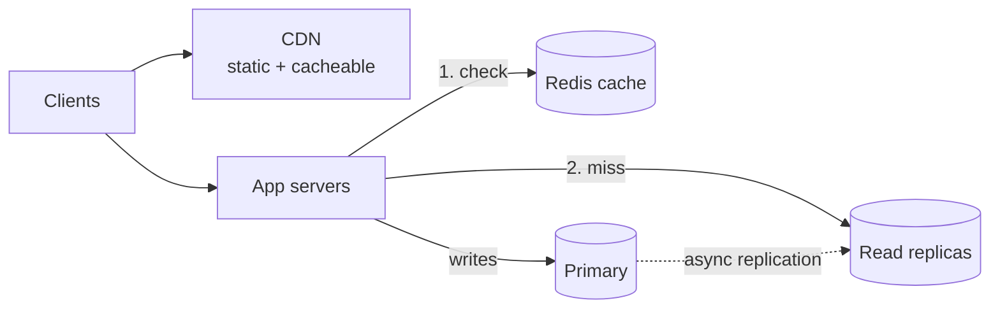
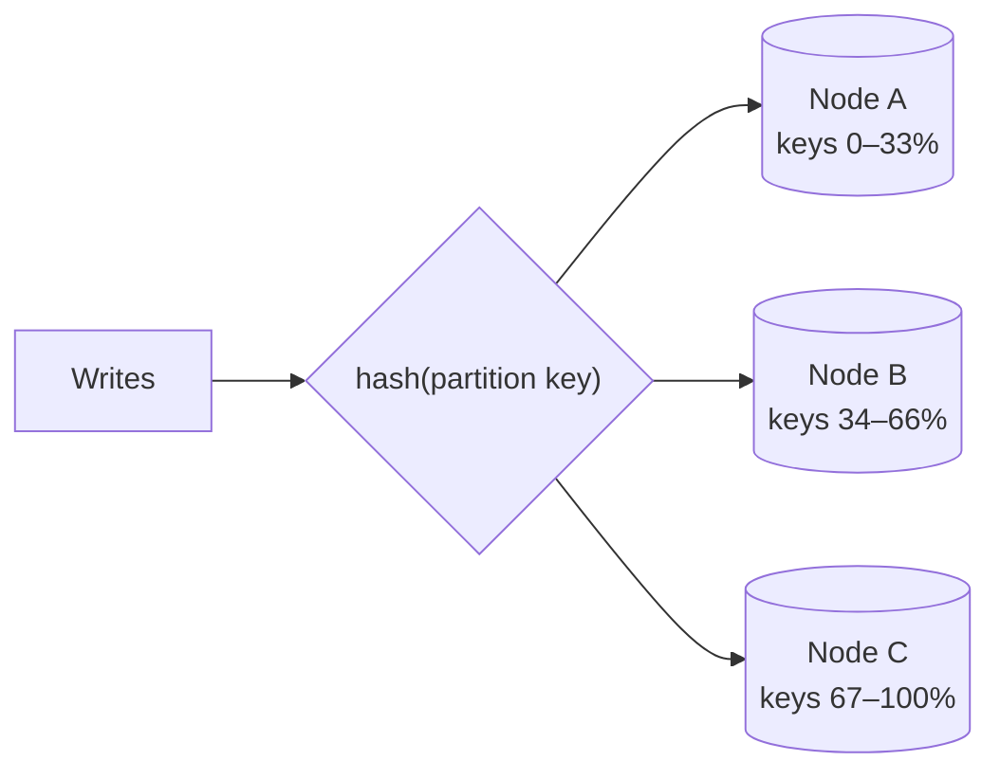

"Which database would you use?" comes up in almost every design interview. A product name alone is a weak answer. Interviewers want the access pattern that led you to the choice, and the trade-off you accepted.

## TL;DR

- **Start from the access pattern, not the product.** Know how data is written, how it's read, and how much of each.
- **Default to a relational database** (PostgreSQL). Move away only when a requirement forces it.
- **High reads** → replicas + cache. **High writes** → a partitioned LSM store (Cassandra, DynamoDB). **Search** → an inverted index (Elasticsearch). **Analytics** → a columnar store (ClickHouse). **Metrics** → a time-series database.
- **Most real systems use several stores**, one per access pattern, kept in sync by change data capture.
- **Always say the trade-off out loud**: what the choice costs you.

## Try it: pick a database

Answer a few questions about your workload. Each answer narrows the choice the same way you'd reason through it in an interview.

<DatabasePicker />

## Ask these five questions first

<StepCards>
  <StepCard n={1} title="What shape is the data?">
    Rows with relationships, self-contained documents, key → blob, time-stamped points, a graph, vectors, or files?
  </StepCard>
  <StepCard n={2} title="How is it read?">
    By primary key, by range, by arbitrary filters, by keywords, by similarity, or as aggregates over everything? Write down the top 3 queries.
  </StepCard>
  <StepCard n={3} title="Read/write ratio and volume?">
    A 100:1 read-heavy profile page and a 1:1 chat log need very different stores. Put numbers on peak QPS and data size.
  </StepCard>
  <StepCard n={4} title="How consistent must it be?">
    Money and inventory need transactions. A like count or a feed can be eventually consistent.
  </StepCard>
  <StepCard n={5} title="How big, and who runs it?">
    Does it fit on one machine for the next 2–3 years? Is a managed service OK? Every new store adds backups, monitoring and on-call.
  </StepCard>
</StepCards>

<Callout tone="blue" title="Default to PostgreSQL, then justify the move" icon="lightbulb">
  One Postgres primary with replicas handles far more than most interview systems need: tens of thousands of writes per second and terabytes of data. Instagram, Notion and Figma all scaled on Postgres for years. Reach for something else when you can name the requirement it fails: write volume beyond one primary, full-text relevance, time-window analytics, deep graph traversal, or similarity search.
</Callout>

## The database families at a glance

Pick the workloads your system has. The families that fit all of them rise to the top. Click any dot to see why it got that rating.

<DatabaseWorkloadMatrix />

## Workload cookbook

The common interview scenarios, and what to reach for in each one.

| Scenario | What makes it hard | Reach for | Supporting technique |
|---|---|---|---|
| **High reads** (profiles, catalogs) | One node can't serve all the reads | [Relational](/system-design/databases/relational-databases) + [Redis](/system-design/databases/key-value-stores) | Read replicas, cache-aside, CDN for static content |
| **High writes** (chat, events, IoT) | Writes saturate one primary | [Wide-column](/system-design/databases/wide-column-stores) (Cassandra) or DynamoDB | Partition by a high-cardinality key, LSM storage |
| **Full-text search** | `LIKE '%term%'` can't rank, and scans everything | [Search engine](/system-design/databases/search-engines) | Sync from the primary DB with CDC |
| **Typeahead** | Results needed in under 50 ms per keystroke | Search engine or a Redis trie / sorted set | Precompute top-k per prefix |
| **Analytics / dashboards** | Aggregates scan billions of rows | [Columnar OLAP](/system-design/databases/analytical-databases) (ClickHouse, BigQuery) | Stream events from Kafka, pre-aggregate |
| **Metrics & monitoring** | Millions of points per second, window queries | [Time-series DB](/system-design/databases/time-series-databases) | Downsample old data, set retention |
| **Counters, leaderboards, rate limits** | Hot keys updated constantly | Redis (INCR, sorted sets) | Periodically flush to the durable store |
| **Payments / ledger** | Must never lose or double-apply money | Relational with serializable transactions | Idempotency keys, append-only ledger table |
| **Global strong consistency** | Writes in many regions, one truth | [NewSQL](/system-design/databases/newsql-databases) (Spanner, CockroachDB) | Place data near its users |
| **Social graph, fraud rings** | Queries 3+ hops deep | [Graph DB](/system-design/databases/graph-databases), or SQL + cache for 1–2 hops | Cache adjacency lists (Facebook TAO) |
| **Semantic search, RAG** | "Similar meaning", not equal words | [Vector DB](/system-design/databases/vector-databases) or pgvector | Hybrid: BM25 + vectors, then rerank |
| **Nearby / geo** | 2D range queries | PostGIS, Redis GEO, or Elasticsearch | [Geohash / quadtree](/system-design/patterns/geospatial-indexing) |
| **Images, video, files** | Huge blobs | [Object storage](/system-design/databases/object-storage) (S3) + CDN | Metadata in a DB, pre-signed upload URLs |

## High reads vs high writes

The two most common scaling questions have different answers.

### Scaling reads: copy the data closer to the reader

- **Cache** the hottest keys (most reads hit about 20% of the data). See [Caching](/system-design/patterns/caching).
- **Read replicas** spread the rest. Watch out for replication lag: send a user's own reads to the primary right after they write. See [Single-Leader Replication](/system-design/databases/single-leader-replication).
- **Denormalize** or precompute views (e.g. a feed table) so each read is one lookup.

### Scaling writes: split the data so no node takes every write

- **Partition** by a key with many distinct values (`user_id`, `channel_id + time bucket`). See [Sharding](/system-design/patterns/sharding) and [Consistent Hashing](/system-design/patterns/consistent-hashing).
- **Use an LSM-tree store** (Cassandra, ScyllaDB, RocksDB). It turns random writes into sequential appends. See [LSM Trees](/system-design/databases/lsm-trees).
- **Buffer** bursts through a queue, and batch writes.
- **Avoid hot partitions.** A celebrity or a busy channel can overload one node. Discord's Cassandra cluster suffered exactly this.

## SQL vs NoSQL is the wrong question

"NoSQL" covers five very different families. Compare the specific families instead. Try relational vs wide-column, or document vs key-value:

<CompareDatabases a="relational" b="wide-column" />

## Using more than one store

Real systems rarely use one database. Each access pattern gets the store built for it, and one store remains the **source of truth**. The others are derived from it, usually through change data capture (CDC). Step through how an e-commerce backend grows:

<AnimatedDiagram name="databases/polyglot-ecommerce" caption="One store per access pattern, with Postgres as the source of truth" step={1} stepper />

Every extra store costs you sync lag, another failure mode and more on-call. Add one only when an access pattern clearly diverges. See [Polyglot Persistence](/system-design/databases/polyglot-persistence).

## Practice: what would you pick?

Decide before you reveal.

<ScenarioGrid>
  <ScenarioCard workload="Read-heavy" title="URL shortener redirects" problem="100M new links a month, 10B redirects a month (100:1 reads). Each redirect looks up one short code and must return in under 10 ms." pick="Key-value store (DynamoDB) + Redis cache">
    Every read is a lookup by exact key, so you don't need joins or a query language. A key-value store partitions cleanly by short code. A Redis cache in front serves the hot links from memory. A relational DB also works at this size; key-value just makes the access pattern explicit.
  </ScenarioCard>
  <ScenarioCard workload="Write-heavy" title="Chat message history" problem="Billions of messages a day. Reads are 'last 50 messages in this channel', then scroll back. Messages are rarely edited." pick="Wide-column store (Cassandra / ScyllaDB)">
    Partition by `(channel_id, time_bucket)` and cluster by `message_id` descending. A channel's history is then one sequential read. LSM storage absorbs the write volume. Time buckets keep busy channels from growing into unbounded partitions.
  </ScenarioCard>
  <ScenarioCard workload="Search" title="Product search with filters" problem="Shoppers type 'red running shoes' and filter by brand, size and price. Results must tolerate typos and rank by relevance." pick="Elasticsearch, fed from Postgres by CDC">
    An inverted index handles tokenizing, typo tolerance (fuzzy match), BM25 ranking and facet counts. Postgres stays the source of truth for price and stock. A CDC pipeline keeps the index about a second behind, which is fine for search.
  </ScenarioCard>
  <ScenarioCard workload="Analytics" title="Ad click dashboard" problem="5B click events a day. Advertisers want clicks per campaign per hour for the last 90 days, refreshed every minute." pick="Kafka → ClickHouse (columnar OLAP)">
    Each query reads 2–3 columns across billions of rows, the workload columnar storage is built for. Stream events through Kafka, roll them up per minute with materialized views, and keep raw data cheap in object storage.
  </ScenarioCard>
</ScenarioGrid>

## When to revisit your choice

| Signal | What it means | Possible move |
|---|---|---|
| Ad-hoc joins piling up in a document store | The data is relational after all | Add a relational read model, or migrate |
| Search cluster CPU burned on aggregations | Search engine used as an analytics engine | Offload to an OLAP store |
| One partition far hotter than the rest | Poor partition key, or a celebrity key | Add a time bucket or salt to the key, cache the hot key |
| Primary CPU or IOPS pinned by writes | Outgrew a single leader | Shard by tenant/user, or move to NewSQL / wide-column |
| Replica lag causing "my post disappeared" bugs | Read-your-writes broken | Route a user's reads to the leader after they write |
| Time-window queries slow on a wide-column store | Using the wrong tool for time series | Adopt a time-series database |

## Common pitfalls

- **Naming a product before the access pattern.** "MongoDB because it scales" is a red flag. Say what the access pattern is first.
- **Picking NoSQL for scale you don't have.** You give up joins and transactions for throughput you'll never use.
- **Treating a search index or cache as the source of truth.** Both can lose data or lag behind writes.
- **Ignoring the partition key.** In distributed stores, the key decides throughput, hot spots and which queries are even possible.
- **Adding a store per feature.** Each new database brings its own backups, monitoring, upgrades and failure modes.

## How to answer in an interview

> "Orders need transactions and are read by user, so I'll put them in **Postgres**, which handles our ~2K writes/s on one primary. Product reads are 100:1, so I'll add **read replicas and a Redis cache**. Search needs relevance ranking, so I'll stream changes from Postgres via **CDC into Elasticsearch**, accepting about a second of lag."

State the access pattern, the store, the number that justifies it, and the trade-off. Then move on.

## Related

[Relational](/system-design/databases/relational-databases) · [Key-Value](/system-design/databases/key-value-stores) · [Wide-Column](/system-design/databases/wide-column-stores) · [Search Engines](/system-design/databases/search-engines) · [Caching](/system-design/patterns/caching) · [Sharding](/system-design/patterns/sharding) · [Consistency Models](/system-design/patterns/consistency-models)

## Further reading

- [Understand data store models (Azure Architecture Center)](https://learn.microsoft.com/en-us/azure/architecture/data-guide/technology-choices/understand-data-store-models)
- Martin Kleppmann, *Designing Data-Intensive Applications*, chapters 3–4 (data models, storage engines, OLTP vs OLAP)
- [How Discord stores trillions of messages](https://discord.com/blog/how-discord-stores-trillions-of-messages)
- [Sharding Postgres at Notion](https://www.notion.com/blog/sharding-postgres-at-notion)
- [How Figma's databases team lived to tell the scale](https://www.figma.com/blog/how-figmas-databases-team-lived-to-tell-the-scale/)

<InterviewQuestions>
  <InterviewQuestion question="How do you decide between SQL and NoSQL for a new service?" category="Concepts" level="Mid">
    Start from the access patterns, not the label. If the data is relational, needs multi-row transactions, or the queries aren't known yet, use SQL; one Postgres primary goes very far. Pick a specific NoSQL family when a requirement forces it: key-value for huge key-lookup scale, wide-column for sustained high write volume with known queries, document for self-contained aggregates with varying shape. Then name the trade-off: usually weaker transactions and less query flexibility.
  </InterviewQuestion>
  <InterviewQuestion question="Your service is 100:1 read-heavy. How do you scale the database?" category="Scaling" level="Mid">
    First, cache-aside with Redis for hot keys, aiming for a 90%+ hit rate. Then read replicas for the long tail, routing a user's own reads to the primary right after they write to avoid stale reads. Denormalize or precompute expensive views so each read is a single lookup, and serve static assets from a CDN. Sharding is only needed if writes or data size also outgrow one primary.
  </InterviewQuestion>
  <InterviewQuestion question="You need to ingest 1M events per second. What changes?" category="Scaling" level="Senior">
    No single primary takes that, so partition the data. Buffer events through Kafka. Write them to an LSM-based, partitioned store (Cassandra/ScyllaDB, or DynamoDB) keyed by a high-cardinality key plus a time bucket to avoid hot partitions. Batch writes. If the reads are aggregations, also stream into a columnar OLAP store like ClickHouse instead of querying the write store.
  </InterviewQuestion>
  <InterviewQuestion question="Why not just use Elasticsearch as the main database?" category="Trade-offs" level="Mid">
    Search engines are eventually consistent (refresh about every second), have no multi-document transactions, and mapping changes often require a full reindex. Keep the source of truth in a transactional database and feed the index with CDC or dual writes from an outbox. Then the index can always be rebuilt.
  </InterviewQuestion>
  <InterviewQuestion question="When is it worth adding a second database to a system?" category="Trade-offs" level="Senior">
    When an access pattern clearly diverges from what the primary store does well: full-text relevance, analytics scans, time-window metrics, similarity search, or write volume beyond one leader. The price is a sync pipeline (usually CDC), lag between stores, and more operational load. Choose one source of truth and make every other store rebuildable from it.
  </InterviewQuestion>
</InterviewQuestions>
