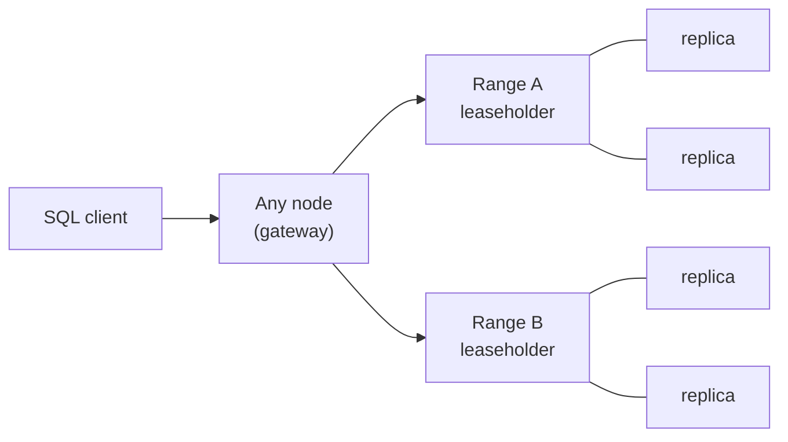

NewSQL (distributed SQL) databases keep what you like about relational databases, SQL and ACID transactions, and add what NoSQL promised: automatic sharding, replication and survival of node or region failures. Spanner, CockroachDB, YugabyteDB and TiDB are the main ones.

<DbProfile id="newsql" />

## How it works

<StepCards>
  <StepCard n={1} title="Split into ranges">
    Tables are cut into key ranges (~512 MB each). Ranges split and move automatically as data grows.
  </StepCard>
  <StepCard n={2} title="Replicate with consensus">
    Each range has 3 or 5 replicas forming a Raft or Paxos group. A write commits once a majority agrees.
  </StepCard>
  <StepCard n={3} title="Coordinate transactions">
    A transaction touching several ranges uses a distributed commit protocol, with timestamps to order transactions globally.
  </StepCard>
</StepCards>



**Spanner's trick:** TrueTime uses GPS clocks and atomic clocks to bound clock uncertainty, then waits it out, so timestamps give external consistency worldwide. CockroachDB uses hybrid logical clocks plus uncertainty intervals instead.

## How the data looks

It's SQL. The new part is controlling **where data lives**.

<DataModelView title="Global payments">
<DataModelTab label="Schema">

```sql
-- CockroachDB: each row lives in its home region
CREATE TABLE accounts (
  id       UUID PRIMARY KEY DEFAULT gen_random_uuid(),   -- random, not sequential
  region   crdb_internal_region NOT NULL,
  owner    STRING,
  balance  DECIMAL NOT NULL CHECK (balance >= 0)
) LOCALITY REGIONAL BY ROW;
```

</DataModelTab>
<DataModelTab label="Transaction">

```sql
-- Serializable by default, even across ranges and regions
BEGIN;
UPDATE accounts SET balance = balance - 100 WHERE id = 'a…';
UPDATE accounts SET balance = balance + 100 WHERE id = 'b…';
COMMIT;   -- client retries on serialization error (40001)
```

</DataModelTab>
</DataModelView>

## The cost: latency

Every commit needs a majority of replicas to agree.

| Replica placement | Commit latency | Survives |
|---|---|---|
| 3 replicas, one region (3 zones) | ~2–10 ms | A zone failure |
| 5 replicas, 3 regions | ~50–150 ms (cross-region round trip) | A region failure |
| Per-row home region | Local writes fast; cross-region transactions slow | Configurable |

## NewSQL vs sharded Postgres

<CompareDatabases a="newsql" b="relational" />

| | Sharded Postgres (DIY) | Distributed SQL |
|---|---|---|
| Cross-shard transactions | Your problem | Built in |
| Resharding | A migration project | Automatic range splits |
| Single-row latency | Lowest | Higher (consensus) |
| Maturity / ecosystem | Huge | Smaller, improving |
| Cost | Lower | Higher (≥3 replicas, licenses) |

## Workload scenarios

<ScenarioGrid>
  <ScenarioCard workload="Global consistency" title="Multi-region payments ledger" problem="Customers in the EU, US and APAC. Balances must never go negative, and the system must survive losing a whole region." pick="Spanner / CockroachDB with regional replicas">
    Serializable transactions with consensus replication across regions. Pin each account to its home region so most transactions commit locally. Only rare cross-region transfers pay the long round trip.
  </ScenarioCard>
  <ScenarioCard workload="Scale" title="Inventory outgrows one primary" problem="An e-commerce platform needs ACID inventory updates at 50K writes/s across 100M SKUs, and the team doesn't want to build sharding." pick="Distributed SQL">
    Ranges spread SKUs across nodes, and transactions keep reserve-then-decrement correct. Use random or hashed keys so writes don't pile onto the last range.
  </ScenarioCard>
  <ScenarioCard workload="Overkill" title="A startup's first database" problem="One region, 200 writes/s, a small team." pick="Plain Postgres">
    Distributed SQL adds latency, cost and new failure modes for scale you don't have. One managed Postgres with a replica is simpler and faster.
  </ScenarioCard>
</ScenarioGrid>

## In the wild

- **Google Spanner** backs AdWords/Ads, Gmail metadata and Google Pay.
- **CockroachDB** is used by DoorDash, Netflix and many fintechs for multi-region data.
- **TiDB** is popular for MySQL-compatible scale-out (PingCAP).

## Common pitfalls

- **Sequential primary keys** (auto-increment, timestamps): every insert hits one range. Use UUIDs or hashed keys.
- **Ignoring retries**: serializable transactions abort on conflict, so the client must retry.
- **Cross-region transactions in the hot path**, adding 100+ ms per write.
- **Assuming "Postgres-compatible" means everything Postgres does** (extensions, some features).

## How to answer in an interview

> "Balances need serializable transactions, and we must survive a region outage, so I'll use **Spanner or CockroachDB** with 5 replicas across 3 regions. Accounts are homed in their user's region so most commits stay local. I'll use UUID keys to avoid hotspots, and the client retries on serialization errors."

## Related

[Choosing a Database](/system-design/databases/choosing-a-database) · [Relational](/system-design/databases/relational-databases) · [Leader Election](/system-design/patterns/leader-election) · [Consistency Models](/system-design/patterns/consistency-models) · [Saga](/system-design/patterns/saga)

## Further reading

- [Spanner: Google's globally distributed database (OSDI 2012)](https://research.google/pubs/spanner-googles-globally-distributed-database-2/)
- [CockroachDB architecture overview](https://www.cockroachlabs.com/docs/stable/architecture/overview)
- [In search of an understandable consensus algorithm (Raft)](https://raft.github.io/raft.pdf)

<InterviewQuestions>
  <InterviewQuestion question="How does a distributed SQL database provide ACID across shards?" category="Internals" level="Senior">
    Data is split into ranges, each replicated by a Raft or Paxos group, so each range is a durable, consistent log. Multi-range transactions write provisional intents to each range, then atomically flip a transaction record to committed (a two-phase-commit variant). Timestamps from synchronized or hybrid clocks order transactions so reads see a consistent snapshot.
  </InterviewQuestion>
  <InterviewQuestion question="When would you choose sharded Postgres over CockroachDB?" category="Trade-offs" level="Senior">
    When data shards cleanly by tenant or user so nearly all transactions stay within a shard, latency per query matters most, the team knows Postgres deeply, and cost matters. Notion and Figma took this route. Choose distributed SQL when cross-shard transactions are common, resharding by hand would be painful, or you need multi-region writes with strong consistency.
  </InterviewQuestion>
  <InterviewQuestion question="Why are auto-increment keys a problem in distributed SQL?" category="Scaling" level="Mid">
    Ranges are contiguous key spans. Monotonically increasing keys send every insert to the last range, and its leaseholder becomes a hotspot while the other nodes idle. Use random UUIDs, hash-sharded indexes, or prefix the key with a well-distributed value.
  </InterviewQuestion>
</InterviewQuestions>
