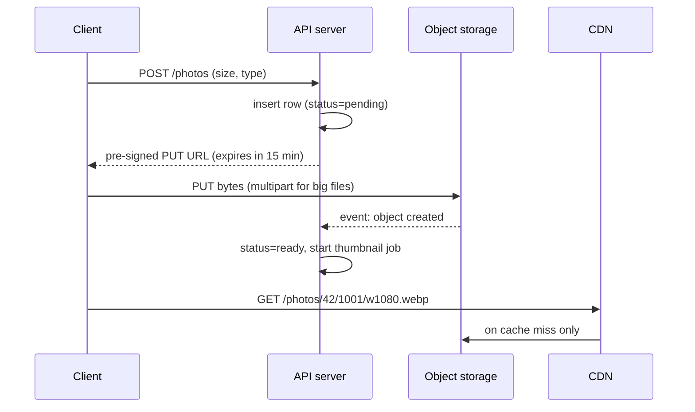

Object storage keeps files of any size, from a 2 KB thumbnail to a 5 TB video, under a key in a bucket. It's cheap, extremely durable and effectively unlimited. In system design it's where every large binary goes, while a database keeps the metadata about it.

<DbProfile id="object" />

## The golden rule: bytes in object storage, metadata in a database

<DataModelView title="Photo sharing">
<DataModelTab label="Database row">

```sql
CREATE TABLE photos (
  id          BIGINT PRIMARY KEY,
  owner_id    BIGINT NOT NULL,
  object_key  TEXT NOT NULL,          -- "photos/42/1001/original.jpg"
  width       INT, height INT,
  bytes       BIGINT,
  status      TEXT NOT NULL,          -- pending | ready | failed
  created_at  TIMESTAMPTZ NOT NULL
);
```

</DataModelTab>
<DataModelTab label="Object keys">

```text
s3://media-prod/photos/42/1001/original.jpg     4.1 MB
s3://media-prod/photos/42/1001/w1080.webp       310 KB
s3://media-prod/photos/42/1001/w320.webp        28 KB

Metadata on each object: Content-Type, Cache-Control, checksum, custom tags.
Operations: PUT, GET (optionally a byte range), DELETE, LIST by prefix.
```

</DataModelTab>
</DataModelView>

## Uploads and downloads that skip your servers

Don't stream gigabytes through your API servers. Hand clients a **pre-signed URL** and let them talk to storage directly.



## Why it scales (and where it doesn't)

- **Flat namespace** spread across many storage nodes. "Folders" are just key prefixes.
- **Durability by erasure coding** across data centers: S3 is designed for 11 nines.
- **Storage tiers**: hot, infrequent access and archive (Glacier) trade retrieval speed for price, with lifecycle rules to move data between them.
- **Strong read-after-write consistency** on S3 since 2020, including overwrites and lists.
- **Where it doesn't fit:** objects are immutable, so you replace them rather than append. Time to first byte is tens of milliseconds, there are no queries over content, and listing millions of keys is slow.

## Workload scenarios

<ScenarioGrid>
  <ScenarioCard workload="Large files" title="Video platform uploads" problem="Creators upload 2 GB videos over flaky mobile networks. Videos get transcoded into several resolutions and streamed worldwide." pick="S3 with multipart upload + transcoding workers + CDN">
    Multipart upload lets a client upload parts in parallel and retry only failed parts. An object-created event triggers transcoding into HLS segments, which are themselves objects served through a CDN. See [YouTube](/system-design-case-studies/case-studies/youtube) and [Netflix](/system-design-case-studies/case-studies/netflix).
  </ScenarioCard>
  <ScenarioCard workload="Analytics" title="Data lake" problem="Petabytes of event logs must be kept cheaply for years and occasionally queried with SQL." pick="S3 + Parquet (Iceberg / Delta) + Trino, Athena or Spark">
    Columnar Parquet files partitioned by date are cheap to store and fast to scan selectively. Table formats like Iceberg add schema evolution and atomic commits on top. See [Analytical Databases](/system-design/databases/analytical-databases).
  </ScenarioCard>
  <ScenarioCard workload="Wrong tool" title="Storing small JSON records in S3" problem="An app stores each 1 KB user setting as its own S3 object and reads 20 of them per page load." pick="Use a database or key-value store">
    Every GET has tens of milliseconds of latency and a per-request cost. Small, frequently read records belong in a database. Object storage is for large or rarely accessed bytes.
  </ScenarioCard>
</ScenarioGrid>

## Common pitfalls

- **Proxying uploads and downloads through app servers** instead of using pre-signed URLs and a CDN.
- **Storing blobs inside the database**: it bloats backups and replication, and buffer-pool memory gets wasted.
- **Public buckets by accident.** Default to private, and serve through a CDN with signed URLs when needed.
- **No lifecycle rules**: old versions and temporary uploads pile up and you pay for them forever.

## How to answer in an interview

> "Photos go to **S3**. Clients upload directly with a pre-signed URL, and a worker makes thumbnails when the object-created event fires. Postgres stores metadata and the object key. Reads go through a **CDN**, so S3 only sees cache misses. Originals move to infrequent-access storage after 30 days."

## Related

[Choosing a Database](/system-design/databases/choosing-a-database) · [Blob Storage & Chunking](/system-design/patterns/blob-storage-and-chunking) · [S3 case study](/system-design-case-studies/case-studies/s3) · [Dropbox case study](/system-design-case-studies/case-studies/dropbox)

## Further reading

- [Amazon S3 strong consistency](https://aws.amazon.com/s3/consistency/)
- [Uploading objects with presigned URLs (AWS docs)](https://docs.aws.amazon.com/AmazonS3/latest/userguide/PresignedUrlUploadObject.html)
- [Building and operating a pretty big storage system called S3 (All Things Distributed)](https://www.allthingsdistributed.com/2023/07/building-and-operating-a-pretty-big-storage-system.html)

<InterviewQuestions>
  <InterviewQuestion question="Why not store images in the database as BLOBs?" category="Trade-offs" level="Junior">
    Large binaries bloat the database, its backups and its replication stream. They waste buffer-pool memory meant for hot rows, and every read flows through the database and your app servers. Object storage is far cheaper per GB, scales without limit and plugs into CDNs. Keep the key and metadata in the database.
  </InterviewQuestion>
  <InterviewQuestion question="How do you let users upload large files reliably?" category="Design" level="Mid">
    The API creates a metadata row and returns pre-signed multipart upload URLs. The client uploads parts in parallel straight to object storage, retries only failed parts, then completes the upload. An object-created event (or a client callback) marks the row ready and triggers processing. Expire unfinished multipart uploads with a lifecycle rule.
  </InterviewQuestion>
  <InterviewQuestion question="How would you serve user photos to a global audience?" category="Scaling" level="Mid">
    Generate several sizes and modern formats (WebP/AVIF) at upload time, store them under content-addressed or versioned keys, and serve them through a CDN with long cache lifetimes. Use signed URLs or cookies for private content. With immutable keys, updates create new keys and you never have to purge the cache.
  </InterviewQuestion>
</InterviewQuestions>
