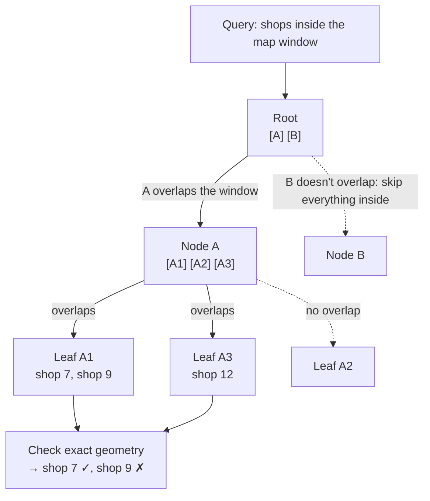

An R-tree indexes shapes and points in space by grouping nearby objects into **bounding rectangles**, nested like folders. It answers "what's inside this map area?" and "what's near me?" without checking every object. PostGIS, SQLite's R*Tree module, Oracle Spatial and MySQL spatial indexes use it.

## TL;DR

- Each node stores **minimum bounding rectangles (MBRs)** that cover all objects below it.
- A query descends only into rectangles that **overlap** the search area, skipping whole regions at once.
- It handles **points and shapes** (polygons, lines), unlike geohashes, which index points.
- **Nearest-neighbor** search walks rectangles in order of distance.
- Rectangles can overlap, so a query may follow several branches. Good insertion (R*-tree) keeps overlap small.

## The idea in plain English

To find coffee shops in a map window, you don't check every shop on Earth. You check which countries overlap the window, then which cities in those countries, then which neighborhoods, and only then the individual shops. An R-tree builds that hierarchy automatically from the data, with boxes instead of borders.

## How a query works



Rectangles are approximations, so the last step checks each candidate's real geometry. That's the **filter → refine** pattern.

## Core concepts

1. **Minimum bounding rectangle.** The smallest axis-aligned box containing an object or a group of children.
2. **Balanced like a B-tree.** Nodes are pages holding many entries, and every leaf is at the same depth.
3. **Insertion.** Choose the child whose rectangle needs the least enlargement. Split overflowing nodes so the new boxes overlap as little as possible.
4. **Overlap is the enemy.** Overlapping rectangles force queries down several paths. R*-trees reinsert entries to reduce overlap.
5. **k-nearest neighbors.** A priority queue ordered by distance from the query point to each rectangle expands the closest boxes first.

## R-tree vs other spatial indexes

| Index | Indexes | Strengths | Used by |
|---|---|---|---|
| **R-tree** | Points and shapes | Polygons, overlaps, kNN; adapts to data density | PostGIS (GiST), SQLite, Oracle |
| **Geohash** | Points | Turns 2D into a 1D string prefix, so it works in any key-value store or B-tree | Redis GEO, Elasticsearch, DynamoDB designs |
| **Quadtree** | Points (and regions) | Simple recursive split of space; good for uneven density | In-memory services (Yelp-style "nearby") |
| **S2 / H3 cells** | Points and regions | Hierarchical cells on the sphere, no edge distortion | Google Maps (S2), Uber (H3) |

See [Geospatial Indexing](/system-design/patterns/geospatial-indexing) for geohash, quadtree and cell-based designs.

## Example: PostGIS

```sql
CREATE TABLE places (
  id   BIGINT PRIMARY KEY,
  name TEXT,
  geom GEOGRAPHY(POINT, 4326)
);
CREATE INDEX places_geom ON places USING GIST (geom);   -- R-tree via GiST

-- 10 nearest places within 2 km
SELECT id, name, ST_Distance(geom, ST_MakePoint(13.40, 52.52)::geography) AS meters
FROM places
WHERE ST_DWithin(geom, ST_MakePoint(13.40, 52.52)::geography, 2000)
ORDER BY geom <-> ST_MakePoint(13.40, 52.52)::geography
LIMIT 10;
```

## Trade-offs

| Choice | Gain | Cost |
|---|---|---|
| R-tree in the database | Rich queries (polygons, kNN, joins with other data) | Write-heavy moving points cause constant updates |
| Geohash in a key-value store | Scales horizontally, simple | Edge effects at cell borders; points only |
| In-memory quadtree | Very fast nearby queries | Must be rebuilt or sharded yourself |

## Real-world examples

- **PostGIS** (R-tree over GiST) backs mapping, logistics and real-estate apps. See the [Zillow case study](/system-design/case-studies/zillow).
- **SQLite's R*Tree module** powers offline maps on mobile devices.
- **Ride-hailing driver locations** usually avoid R-trees: positions change every few seconds, so they use cell-based indexes (geohash, H3) in memory. See [Uber Eats](/system-design/case-studies/uber-eats) and [Google Maps](/system-design/case-studies/google-maps).

## Common pitfalls

- **Rapidly moving points** in an R-tree: each update reshapes rectangles. Use cell-based indexes for live locations.
- **Forgetting the refine step**: bounding boxes return false positives.
- **Treating lat/long as flat** over long distances: use geography types or spherical cells.

## How to answer in an interview

"For static places with 'what's in this map area' and nearest-neighbor queries, I'd use **PostGIS with a GiST R-tree index**. It handles polygons and kNN and joins with listing data. For millions of moving drivers I'd use geohash or H3 cells in memory instead, because R-trees don't like constant updates."

## Related

[Geospatial Indexing](/system-design/patterns/geospatial-indexing) · [B-Trees](/system-design/databases/b-trees) · [Relational Databases](/system-design/databases/relational-databases) · [Search Engines](/system-design/databases/search-engines)

## Further reading

- [R-trees: a dynamic index structure for spatial searching (Guttman, 1984)](https://dl.acm.org/doi/10.1145/602259.602266)
- [PostGIS: spatial indexing](https://postgis.net/workshops/postgis-intro/indexing.html)
- [Uber H3: hexagonal hierarchical spatial index](https://h3geo.org/docs/)

<InterviewQuestions>
  <InterviewQuestion question="How does an R-tree find all points inside a rectangle?" category="Internals" level="Mid">
    Starting at the root, it checks each child's bounding rectangle against the query rectangle and descends only into those that overlap. At the leaves it collects candidates whose boxes overlap, then checks their exact geometry to drop false positives. Whole subtrees whose boxes don't overlap are skipped, which is where the speed comes from.
  </InterviewQuestion>
  <InterviewQuestion question="R-tree or geohash for a 'nearby restaurants' feature?" category="Trade-offs" level="Mid">
    Restaurants rarely move and you may need polygons (delivery zones) and kNN, so PostGIS with an R-tree works well up to large scale. A geohash suits a horizontally scaled key-value design, or Elasticsearch geo queries at very high QPS. For constantly moving entities such as drivers, prefer geohash or H3 cells in memory over an R-tree.
  </InterviewQuestion>
  <InterviewQuestion question="Why can R-tree queries visit more than one branch?" category="Internals" level="Senior">
    Sibling bounding rectangles may overlap, so a query point or area can fall inside several of them, and all must be searched. Poor insertion choices increase overlap and slow queries. R*-trees reduce it with better split heuristics and forced reinsertion, and bulk-loading methods like STR pack static data with minimal overlap.
  </InterviewQuestion>
</InterviewQuestions>
