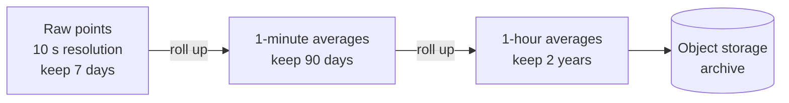

Time-series data is a stream of timestamped measurements: CPU usage, sensor readings, stock ticks. It's written constantly, almost never updated, and queried by time window. Time-series databases are built around exactly that pattern.

<DbProfile id="time-series" />

## What makes time-series data different

<StepCards>
  <StepCard n={1} title="Append-only">
    New points arrive in time order. Old points are rarely changed.
  </StepCard>
  <StepCard n={2} title="Queried by window">
    "Average latency per minute over the last 6 hours", never "find row 42".
  </StepCard>
  <StepCard n={3} title="Recent is hot">
    The last hour is read constantly. Last year is read rarely, and at lower resolution.
  </StepCard>
  <StepCard n={4} title="Highly compressible">
    Neighbouring timestamps and values are similar. Delta and XOR encoding shrink them 10×+.
  </StepCard>
  <StepCard n={5} title="Expires">
    Raw data is kept for days, rollups for months or years. Deleting by time must be cheap.
  </StepCard>
</StepCards>

## How the data looks

A point is **metric name + tags (labels) + timestamp + value**. Each unique combination of tags is one **series**.

<DataModelView title="API latency metrics">
<DataModelTab label="Points">

```text
metric                    tags                                    time                  value
http_request_seconds      service=feed, region=eu, status=200     2026-11-05T10:00:00Z  0.081
http_request_seconds      service=feed, region=eu, status=200     2026-11-05T10:00:10Z  0.076
http_request_seconds      service=feed, region=us, status=500     2026-11-05T10:00:10Z  1.920

Series = one unique tag combination. 3 services × 4 regions × 5 statuses = 60 series.
```

</DataModelTab>
<DataModelTab label="PromQL">

```text
# p99 latency per service over the last 5 minutes
histogram_quantile(0.99,
  sum by (service, le) (rate(http_request_seconds_bucket[5m])))

# error rate per region
sum by (region) (rate(http_requests_total{status=~"5.."}[5m]))
  / sum by (region) (rate(http_requests_total[5m]))
```

</DataModelTab>
<DataModelTab label="TimescaleDB (SQL)">

```sql
SELECT time_bucket('1 minute', time) AS minute,
       service,
       percentile_cont(0.99) WITHIN GROUP (ORDER BY latency) AS p99
FROM requests
WHERE time > now() - interval '6 hours'
GROUP BY minute, service
ORDER BY minute;

-- keep raw data 7 days, 1-minute rollups for a year
SELECT add_retention_policy('requests', INTERVAL '7 days');
```

</DataModelTab>
</DataModelView>

## Why it's fast (and where it isn't)

- **Time-partitioned storage**: data is chunked by time, so a 6-hour query touches only recent chunks, and retention just drops old chunks.
- **Compression**: delta-of-delta for timestamps and XOR for floats (Facebook's Gorilla paper) bring a point down to about 1–2 bytes.
- **Append-optimized writes**, usually LSM-style, handle millions of points per second.
- **Where it breaks:** **high cardinality**. A tag like `user_id` or `request_id` creates millions of series, and memory and index size explode. Those belong in logs or traces, not metrics.

## Downsampling and retention



## Which one?

| Option | Best for |
|---|---|
| **Prometheus** (+ Thanos / Mimir for scale) | Infrastructure and service monitoring, alerting, pull-based scraping |
| **InfluxDB** | IoT and general metrics, push-based |
| **TimescaleDB** | Time series that also need SQL joins with business tables |
| **ClickHouse** | Very large metrics, logs and events with ad-hoc analytics |
| **Cassandra / Bigtable** | Massive raw time series with simple per-device access |

## Workload scenarios

<ScenarioGrid>
  <ScenarioCard workload="Metrics" title="Monitoring 5,000 microservices" problem="Every service exposes ~200 metrics, scraped every 15 s. Dashboards and alerts look at the last few hours, and you need 13 months for capacity planning." pick="Prometheus per cluster + Thanos/Mimir for long-term storage">
    Prometheus scrapes and alerts locally. A long-term store (Thanos, Mimir) deduplicates, downsamples and keeps history cheaply in object storage. Keep labels low-cardinality.
  </ScenarioCard>
  <ScenarioCard workload="IoT" title="Factory sensors" problem="50K sensors report temperature and vibration every second. Engineers query one machine's last 24 hours, and the business wants daily averages per plant." pick="InfluxDB or TimescaleDB with continuous aggregates">
    Device id and plant are tags, and readings are fields. Continuous aggregates precompute the daily per-plant rollups. Raw data expires after 30 days.
  </ScenarioCard>
  <ScenarioCard workload="Cardinality trap" title="Per-user latency metric" problem="A team adds user_id as a label on the request-latency metric for 20M users. Memory triples overnight." pick="Remove the label; use logs or traces">
    Each user becomes a series: 20M × the existing series count. Per-user data belongs in logs, traces or an OLAP store, not in a metrics database.
  </ScenarioCard>
</ScenarioGrid>

## In the wild

- **Facebook's Gorilla** in-memory TSDB introduced the compression tricks most TSDBs now use.
- **Uber's M3** and **Grafana Mimir** run Prometheus-compatible metrics at billions of series.
- **Netflix Atlas** handles operational metrics for streaming.

## Common pitfalls

- **High-cardinality tags**: user ids, request ids and URLs with ids in them.
- **No retention policy**: storage grows forever.
- **Storing events as metrics**: if you need each individual event, use logs or an event store.
- **Querying raw data over long ranges** when a rollup exists.

## How to answer in an interview

> "Metrics are append-only and queried by time window, so I'll use a **time-series database** (Prometheus with Mimir for long-term storage). I'll keep labels low-cardinality (service, region, status), retain raw data for 15 days, and keep 5-minute rollups for 13 months in object storage."

## Related

[Choosing a Database](/system-design/databases/choosing-a-database) · [Analytical Databases](/system-design/databases/analytical-databases) · [Wide-Column Stores](/system-design/databases/wide-column-stores) · [Metrics & Logging case study](/system-design/case-studies/metrics-and-logging)

## Further reading

- [Gorilla: a fast, scalable, in-memory time series database (VLDB 2015)](https://www.vldb.org/pvldb/vol8/p1816-teller.pdf)
- [Prometheus: metric and label naming](https://prometheus.io/docs/practices/naming/)
- [TimescaleDB hypertables](https://docs.timescale.com/use-timescale/latest/hypertables/)

<InterviewQuestions>
  <InterviewQuestion question="Why not store metrics in Postgres or MySQL?" category="Trade-offs" level="Mid">
    You can at small scale, especially with TimescaleDB. At millions of points per second, a general-purpose row store struggles. B-tree index updates on every insert, row overhead dwarfs an 8-byte value, and deleting old data row by row is slow. TSDBs partition by time, compress points to 1–2 bytes, and drop whole chunks for retention.
  </InterviewQuestion>
  <InterviewQuestion question="What is cardinality and why does it matter for metrics?" category="Internals" level="Mid">
    Cardinality is the number of unique series, i.e. unique combinations of label values. Each series costs memory for its index and buffer. Labels with unbounded values (user id, request id, full URL) multiply series into the millions and can take down the database. Keep labels bounded, and put high-cardinality data in logs or traces.
  </InterviewQuestion>
  <InterviewQuestion question="How do you keep a year of metrics without storing every raw point?" category="Design" level="Mid">
    Downsample. Keep raw data for a short window (days), roll it up to 1-minute and then 1-hour aggregates (min, max, avg, count, or histograms for percentiles) with longer retention, and move old blocks to cheap object storage. Queries over long ranges use the rollups.
  </InterviewQuestion>
</InterviewQuestions>
