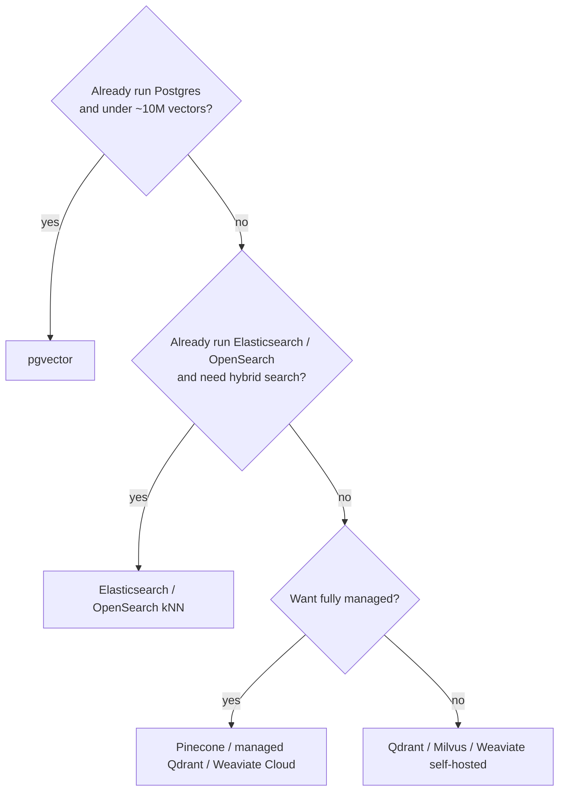

A vector database finds the items **closest in meaning** to a query. Text, images or users are turned into embeddings (lists of numbers) by a model, and the database returns the nearest neighbors in milliseconds, even among hundreds of millions of vectors.

<DbProfile id="vector" />

## Keyword search vs vector search

| Query | Keyword (BM25) finds | Vector search finds |
|---|---|---|
| "cheap laptop for students" | Docs containing those words | "Budget notebooks for college", even with no shared words |
| "error code E1234" | The exact code | Vaguely similar errors, often the wrong one |
| A photo of a red dress | Nothing | Visually similar dresses |

Keywords win on exact terms, names and codes. Vectors win on meaning. Most production systems use **hybrid search**: run both and merge the results (e.g. with reciprocal rank fusion), then optionally rerank.

## How the data looks

<DataModelView title="Semantic search over help articles">
<DataModelTab label="Records">

```json
{
  "id": "doc_77#chunk_3",
  "vector": [0.021, -0.113, 0.087, "… 1,536 numbers …"],
  "payload": {
    "doc_id": "doc_77",
    "title": "Resetting your password",
    "lang": "en",
    "tenant_id": "acme",
    "updated_at": "2026-10-30"
  }
}
```

</DataModelTab>
<DataModelTab label="pgvector">

```sql
CREATE EXTENSION vector;
CREATE TABLE chunks (
  id bigserial PRIMARY KEY,
  doc_id bigint,
  tenant_id bigint,
  body text,
  embedding vector(1536)
);
CREATE INDEX ON chunks USING hnsw (embedding vector_cosine_ops);

-- top 5 chunks for this tenant, by cosine distance
SELECT id, body
FROM chunks
WHERE tenant_id = 7
ORDER BY embedding <=> $1
LIMIT 5;
```

</DataModelTab>
<DataModelTab label="Dedicated DB">

```python
client.query_points(
    collection_name="chunks",
    query=embed("how do I reset my password?"),
    query_filter=Filter(must=[FieldCondition(key="tenant_id", match=MatchValue(value="acme"))]),
    limit=5,
)
```

</DataModelTab>
</DataModelView>

## Why it's fast: approximate nearest neighbors

Comparing the query to every vector (exact k-NN) is O(n). At 100M vectors that's too slow. ANN indexes trade a little recall for a huge speed-up:

| Index | Idea | Trade-off |
|---|---|---|
| **HNSW** | A layered "small world" graph: greedy hops from coarse layers to fine | Fast and accurate; memory-hungry |
| **IVF** | Cluster vectors, then search only the nearest few clusters | Less memory; tune how many clusters to probe |
| **Product quantization (PQ)** | Compress each vector to a few bytes | Much less memory; lower recall |
| **DiskANN** | A graph index kept on SSD | Billions of vectors without all of them in RAM |

You tune **recall vs latency**. Exploring more of the graph (HNSW `ef_search`) or probing more clusters (IVF `nprobe`) means better results but slower queries.

## Which option?



## Workload scenarios

<ScenarioGrid>
  <ScenarioCard workload="Similarity" title="RAG over company docs" problem="200K documents (2M chunks), multi-tenant. Answers must only cite documents the user can access." pick="pgvector in the existing Postgres (or Qdrant), with tenant filters">
    2M vectors fit comfortably on one Postgres. Filter on tenant and permissions in the same query, so you never retrieve forbidden chunks. Add BM25 (Postgres full-text or a search engine) for hybrid retrieval, then rerank.
  </ScenarioCard>
  <ScenarioCard workload="Scale" title="Image similarity for 500M products" problem="Users upload a photo and expect visually similar products within 100 ms." pick="Dedicated vector DB (Milvus / Qdrant) with HNSW + quantization, sharded">
    At 500M vectors, memory dominates. Quantize to cut it 4–16×, shard across nodes, and filter by category in the same query. Store only ids and filter fields in the vector DB, and fetch product details from the catalog.
  </ScenarioCard>
  <ScenarioCard workload="Search" title="Searching error codes" problem="Support agents paste exact error codes like 'E1234-77' and expect the matching runbook." pick="Keyword search, not vectors">
    Embeddings blur exact tokens, so similar-looking codes come back as matches. Exact identifiers belong in a keyword index. Use hybrid search if the same box also handles natural-language questions.
  </ScenarioCard>
</ScenarioGrid>

## Common pitfalls

- **Adding a vector DB when pgvector would do.** A second store means a second copy to keep in sync.
- **Filtering after retrieval**: you get the top 10, filter by tenant, and end up with 0 results. Filter inside the ANN query.
- **Mixing embedding models**: vectors from different models (or versions) aren't comparable. Re-embed everything when you switch.
- **Vectors only**: without keyword search, exact names and codes get poor results.

## How to answer in an interview

> "We have about 5M chunks and already run Postgres, so I'll use **pgvector with an HNSW index**, filtered by tenant in the same query. Retrieval is **hybrid**: BM25 plus vector, merged with reciprocal rank fusion, then reranked. If we pass roughly 50M vectors or the load starts hurting OLTP, I'll move vectors to Qdrant."

## Related

[Choosing a Database](/system-design/databases/choosing-a-database) · [Search Engines](/system-design/databases/search-engines) · [Relational](/system-design/databases/relational-databases) · [Vector databases for GenAI systems](/ai-system-design/genai-system-design/vector-databases)

## Further reading

- [Efficient and robust ANN search using HNSW graphs (Malkov & Yashunin)](https://arxiv.org/abs/1603.09320)
- [pgvector](https://github.com/pgvector/pgvector)
- [ANN-Benchmarks](https://ann-benchmarks.com/)

<InterviewQuestions>
  <InterviewQuestion question="When would you use pgvector instead of a dedicated vector database?" category="Trade-offs" level="Mid">
    When you already run Postgres and the corpus is up to roughly tens of millions of vectors. You get transactions, joins, permission filters and backups in one system, with no sync pipeline. Move to a dedicated engine when vector load starts hurting OLTP latency, the index no longer fits in memory, or you need features like built-in quantization and sharding.
  </InterviewQuestion>
  <InterviewQuestion question="What does 'approximate' mean in ANN search, and how do you tune it?" category="Internals" level="Mid">
    The index doesn't guarantee the true top-k. It explores only part of the space (a graph neighborhood in HNSW, a few clusters in IVF). Recall is the fraction of true neighbors returned. Raise ef_search or nprobe for better recall at higher latency. Measure recall against exact search on a sample, and pick the cheapest setting that meets the target.
  </InterviewQuestion>
  <InterviewQuestion question="Why is hybrid search usually better than vector search alone?" category="Design" level="Mid">
    Vectors capture meaning but blur exact tokens such as names, SKUs and error codes. BM25 nails exact terms but misses synonyms and paraphrases. Running both and merging the rankings (reciprocal rank fusion), then reranking with a cross-encoder, covers both failure modes. It's now the default for RAG retrieval.
  </InterviewQuestion>
</InterviewQuestions>
