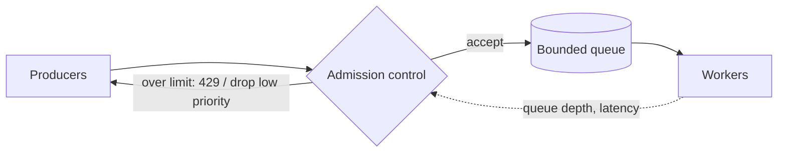

Every system has a capacity limit. Back pressure and load shedding decide what happens when demand exceeds it: degrade on purpose, or collapse.

## TL;DR

- **Back pressure** pushes the slowdown upstream so producers send less.
- **Load shedding** rejects or drops some work to keep the rest healthy.
- Use **bounded queues**; unbounded ones hide overload until memory runs out.
- Shed by **priority** (keep paying users, health checks, writes of critical data).
- Return fast errors (`429`, `503` with `Retry-After`) instead of slow timeouts.

## The idea in plain English

A restaurant with a full kitchen stops seating new tables (back pressure) and turns away walk-ins (shedding) so the orders already in progress still come out hot.

## Core concepts

1. **Bounded queues.** A fixed size forces a decision when full: block, reject or drop.
2. **Signalling.** TCP windows, HTTP `429`/`503`, reactive-streams demand, or consumer lag metrics.
3. **Admission control.** Accept only what you can finish within the deadline.
4. **Priority and fairness.** Classify traffic; shed the least important first; limit per tenant.
5. **Autoscaling is not enough.** It reacts in minutes; overload happens in seconds.
6. **Adaptive limits.** Concurrency limits that shrink as latency rises.

## Architecture

## Deep dive

### Why unbounded queues fail

When arrivals exceed service rate, the queue grows, latency grows with it, and by the time work is processed the client has given up. The system does useless work. A bounded queue plus fast rejection keeps latency predictable.

### Shedding strategies

Drop newest (cheap, preserves in-progress work), drop oldest (when only fresh data matters, e.g. live metrics), or drop by priority. Combine with [circuit breakers](/system-design/patterns/circuit-breaker-and-retries) on callers.

## Trade-offs

| Choice | Gain | Cost |
|---|---|---|
| Block producers | No data loss | Pushes latency upstream |
| Drop work | System stays responsive | Some data or requests lost |
| Bigger queue | Absorbs short bursts | Longer latency, memory risk |

## Real-world examples

- Ingestion overload: [Metrics and Logging](/system-design-case-studies/case-studies/metrics-and-logging).
- Consumer lag and partition limits: [Distributed Message Queue](/system-design-case-studies/case-studies/distributed-message-queue).
- Ticket on-sales with huge spikes (waiting rooms): [Ticketmaster](/system-design-case-studies/case-studies/ticketmaster).
- Token-limited model serving: [ChatGPT](/system-design-case-studies/case-studies/chatgpt).
- Politeness limits per host: [Web Crawler](/system-design-case-studies/case-studies/web-crawler).

## Common pitfalls

- Infinite buffers and retries without limits.
- Treating all requests as equal priority.
- Slow failure (long timeouts) instead of fast rejection.
- Shedding the health check and causing restarts.

## How to answer in an interview

Name the bottleneck, bound the queue, say what gets rejected first and how callers learn about it, and mention a waiting room for planned spikes.

## Related patterns

[Rate Limiting](/system-design/patterns/rate-limiting) · [Message Queues](/system-design/patterns/message-queues) · [Circuit Breaker and Retries](/system-design/patterns/circuit-breaker-and-retries)

## Further reading

- [Using load shedding to avoid overload (AWS Builders' Library)](https://aws.amazon.com/builders-library/using-load-shedding-to-avoid-overload/)
- [Handling overload (Google SRE Book)](https://sre.google/sre-book/handling-overload/)

<InterviewQuestions>
  <InterviewQuestion question="Back pressure vs load shedding?" category="Concepts" level="Mid">
    Back pressure slows producers so work is not lost; load shedding drops or rejects work to protect capacity. Real systems use both, depending on whether the work can be delayed.
  </InterviewQuestion>
  <InterviewQuestion question="Why are unbounded queues dangerous?" category="Reliability" level="Mid">
    They convert overload into growing latency and memory use, so work is processed after its deadline and the service eventually crashes.
  </InterviewQuestion>
  <InterviewQuestion question="How would you handle a sudden 100x traffic spike on a ticket sale?" category="Design" level="Senior">
    Put a virtual waiting room in front, admit users at the rate the backend can handle, prioritise checkout over browsing, shed or cache read traffic, and return fast errors for the rest.
  </InterviewQuestion>
</InterviewQuestions>
