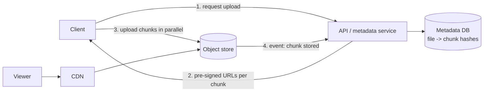

Videos, photos and documents are too large and too numerous for a relational database. The pattern is: metadata in a database, bytes in object storage, delivery through a CDN.

## TL;DR

- Keep **metadata** in a database and **bytes** in an object store.
- Split large files into **chunks** for parallel, **resumable** transfer and efficient sync.
- **Content-addressed chunks** (hash as the key) give **deduplication**.
- Use **pre-signed URLs** so clients upload and download directly, bypassing your servers.
- Serve popular content through a **CDN**.

## The idea in plain English

A warehouse (object store) holds boxes; a catalogue (database) says what is in each box and where. Large shipments arrive in pallets (chunks) so a dropped truck means resending one pallet, not everything.

## Core concepts

1. **Object storage.** Flat namespace of immutable objects with replication or erasure coding for durability.
2. **Chunking.** Fixed-size (for example 4-8 MB) or content-defined chunks.
3. **Resumable / multipart upload.** Upload parts independently; track which exist; complete when all arrive.
4. **Dedup.** Hash each chunk; store only unseen hashes; files become lists of chunk hashes.
5. **Delta sync.** Only changed chunks transfer when a file is edited.
6. **Pre-signed URLs.** Time-limited URLs grant direct access to a specific object.
7. **CDN and tiering.** Hot content at the edge; cold data on cheaper storage classes.

## Architecture

## Deep dive

### Dedup and security

Cross-user dedup can leak whether someone else has a file; many products dedup per user or per account and encrypt before upload where privacy matters.

### Durability

Object stores replicate across zones or use erasure coding (data plus parity shards) to reach very high durability at lower storage overhead than full copies.

## Trade-offs

| Choice | Gain | Cost |
|---|---|---|
| Small chunks | Fine-grained resume and dedup | More metadata, more requests |
| Large chunks | Less overhead | Costly retries |
| Direct upload | Offloads servers | More client logic, URL security |

## Real-world examples

- File sync and chunk dedup: [Dropbox](/system-design/case-studies/dropbox).
- Building the store itself: [S3](/system-design/case-studies/s3).
- Upload, transcode and stream: [YouTube](/system-design/case-studies/youtube), [Netflix](/system-design/case-studies/netflix), [TikTok](/system-design/case-studies/tiktok).
- Photos and media: [Instagram](/system-design/case-studies/instagram), [Facebook Messenger](/system-design/case-studies/facebook-messenger).
- Large generated archives: [User Data Export](/system-design/case-studies/user-data-export).

## Common pitfalls

- Proxying large uploads through app servers.
- Pre-signed URLs with long lifetimes or broad scope.
- Not cleaning up abandoned multipart uploads.
- Storing blobs in the primary database.

## How to answer in an interview

Separate metadata from bytes, describe the upload path with chunks and pre-signed URLs, add dedup and CDN where relevant, and mention durability and cleanup.

## Related patterns

[Caching](/system-design/patterns/caching) · [Message Queues](/system-design/patterns/message-queues) · [Consistent Hashing](/system-design/patterns/consistent-hashing)

## Further reading

- [Amazon S3: multipart upload overview](https://docs.aws.amazon.com/AmazonS3/latest/userguide/mpuoverview.html)
- [Streaming File Synchronization (Dropbox Tech Blog)](https://dropbox.tech/infrastructure/streaming-file-synchronization)

<InterviewQuestions>
  <InterviewQuestion question="How do you upload a 5 GB file reliably?" category="Design" level="Mid">
    Use multipart or chunked upload with pre-signed URLs, upload parts in parallel, record completed parts so the upload can resume, verify checksums and finalise when all parts arrive.
  </InterviewQuestion>
  <InterviewQuestion question="How does chunk-level deduplication work?" category="Concepts" level="Mid">
    Each chunk is hashed; if the hash already exists, only a reference is stored. A file is a list of chunk hashes, so identical chunks are stored once.
  </InterviewQuestion>
  <InterviewQuestion question="Why use pre-signed URLs?" category="Architecture" level="Junior">
    They let clients transfer data directly to storage with limited, expiring permission, keeping large traffic off your application servers.
  </InterviewQuestion>
</InterviewQuestions>
