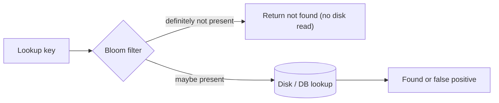

Some questions do not need exact answers, just cheap ones: is this URL already crawled, is this key definitely not in the table, how many unique visitors today?

## TL;DR

- A **Bloom filter** answers "possibly in the set" or "definitely not", using a bit array and several hashes.
- No false negatives; a tunable rate of **false positives**.
- It cannot delete (use a **counting Bloom filter** or cuckoo filter).
- **HyperLogLog** estimates unique counts; **Count-Min Sketch** estimates frequencies.
- Typical use: avoid expensive lookups for items that are not there.

## The idea in plain English

A bouncer with a rough memory of faces: if they say "never seen you", that is certain; if they say "you look familiar", check the guest list to be sure.

## Core concepts

1. **Structure.** `m` bits, `k` hash functions. Insert sets `k` bits; lookup checks all `k`.
2. **Sizing.** About 10 bits per item gives roughly 1% false positives with `k` near 7.
3. **No deletes.** Clearing a bit may affect other items; counting filters keep counters instead.
4. **HyperLogLog.** Uses the longest run of leading zeros in hashes to estimate distinct counts in kilobytes.
5. **Count-Min Sketch.** A grid of counters; estimates item frequency, never under-counts.
6. **Where it sits.** In front of a cache, database or disk lookup.

## Architecture

## Deep dive

### LSM trees

Databases built on [LSM trees and SSTables](/system-design/databases/lsm-trees) keep a Bloom filter per SSTable so reads skip files that cannot contain the key.

### Choosing rates

False positives only cost an extra lookup, so a few percent is often fine. Size for the expected number of items; an overfilled filter degrades quickly.

## Trade-offs

| Choice | Gain | Cost |
|---|---|---|
| Bloom filter | Tiny memory, fast | False positives, no delete |
| Exact set | Exact answers | Much more memory |

## Real-world examples

- Seen-URL check: [Web Crawler](/system-design-case-studies/case-studies/web-crawler).
- Skipping disk reads for missing keys: [Key Value Store](/system-design-case-studies/case-studies/key-value-store), [S3](/system-design-case-studies/case-studies/s3).
- Unique counts and top-k trends: [Metrics and Logging](/system-design-case-studies/case-studies/metrics-and-logging), [Typeahead](/system-design-case-studies/case-studies/typeahead).
- Avoiding repeats in feeds and swipes: [Tinder](/system-design-case-studies/case-studies/tinder), [TikTok](/system-design-case-studies/case-studies/tiktok).

## Common pitfalls

- Using it where a false positive is unacceptable without a confirm step.
- Never resizing as data grows.
- Expecting deletion support.

## How to answer in an interview

Mention it when you need cheap membership tests at huge scale; give the "no false negatives" property and name the exact lookup that follows a positive.

## Related patterns

[Caching](/system-design/patterns/caching) · [Sharding](/system-design/patterns/sharding) · [LSM Trees](/system-design/databases/lsm-trees)

## Further reading

- [Space/Time Trade-offs in Hash Coding with Allowable Errors (Bloom, 1970)](https://dl.acm.org/doi/10.1145/362686.362692)
- [HyperLogLog in Practice (Google)](https://research.google/pubs/hyperloglog-in-practice-algorithmic-engineering-of-a-state-of-the-art-cardinality-estimation-algorithm/)

<InterviewQuestions>
  <InterviewQuestion question="Can a Bloom filter return a false negative?" category="Concepts" level="Junior">
    No. If an item was inserted, all its bits are set, so lookup says "maybe present". It can return false positives.
  </InterviewQuestion>
  <InterviewQuestion question="How would you support deletes?" category="Concepts" level="Mid">
    Use a counting Bloom filter (counters instead of bits) or a cuckoo filter, accepting more memory.
  </InterviewQuestion>
  <InterviewQuestion question="How do you count unique visitors across billions of events?" category="Design" level="Senior">
    Use HyperLogLog, which estimates distinct counts in a few kilobytes with around 1% error and supports merging sketches from many shards.
  </InterviewQuestion>
</InterviewQuestions>
