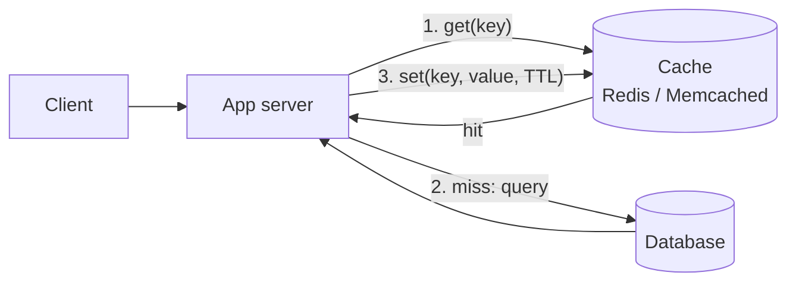

Caching is the first lever almost every design pulls to cut latency and protect the database. Interviewers expect you to name a strategy, an eviction policy and an invalidation plan, not just say "add Redis".

## TL;DR

- A cache stores copies of expensive-to-compute or slow-to-fetch data in faster memory.
- **Cache-aside** is the default: the app checks the cache, falls back to the database, then fills the cache.
- **Write-through** and **write-back** move writes through the cache; the first is safer, the second is faster.
- **Eviction** (LRU, LFU, TTL) decides what to drop; **invalidation** decides when data is stale.
- Watch for **stampedes**, **hot keys** and **stale reads**.

## The idea in plain English

Reading from memory takes microseconds; reading from a database over the network takes milliseconds. If the same data is read many times, keep a copy nearby. The cost is that the copy can go out of date, so every cache design is a decision about how stale is acceptable.

## Core concepts

1. **Cache-aside (lazy loading).** App reads cache; on a miss it reads the database and writes the result to the cache. Simple and resilient, but the first read is slow and data can go stale.
2. **Read-through.** The cache itself loads from the database on a miss. Same behavior, logic lives in the cache layer.
3. **Write-through.** Writes go to cache and database together. Reads stay fresh; writes are slower.
4. **Write-back (write-behind).** Writes hit the cache and are flushed to the database later. Very fast writes, but data can be lost if the cache fails first.
5. **Eviction.** LRU drops the least recently used, LFU the least frequently used, TTL expires entries after a fixed time.
6. **Invalidation.** Delete or update the cache entry when the source changes, or rely on short TTLs.
7. **Where caches live.** Browser, CDN, API gateway, application (in-process), distributed cache (Redis, Memcached), database buffer pool.

## Architecture

## Deep dive

### Cache stampede

When a popular key expires, thousands of requests miss at once and all hit the database. Fixes:

- **Request coalescing / single flight:** only one request rebuilds the value; others wait.
- **Jittered TTLs:** add random seconds so keys do not expire together.
- **Early refresh:** refresh in the background shortly before expiry.
- **Serve stale while revalidating.**

### Hot keys

One key (a celebrity profile) can overload a single cache node. Replicate the key across nodes, add a small in-process cache in front, or split it into suffixed copies (`key#1`..`key#N`) and read one at random.

### Consistency

Updating the database and deleting the cache key is the common approach. A race between a read refilling the cache and a write can leave stale data, which a short TTL bounds.

## Trade-offs

| Choice | Gain | Cost |
|---|---|---|
| Cache-aside | Simple, fails safe | Stale reads, cold start |
| Write-through | Fresh reads | Slower writes, caches unread data |
| Write-back | Fast writes | Risk of data loss |
| Long TTL | High hit rate | More staleness |

## Real-world examples

- Twitter and Instagram cache timelines and profile data; see [Twitter](/system-design/case-studies/twitter) and [Instagram](/system-design/case-studies/instagram).
- A URL shortener is read-heavy and caches hot short codes: [URL Shortener](/system-design/case-studies/url-shortener).
- Typeahead caches popular prefixes: [Typeahead](/system-design/case-studies/typeahead).
- Video and image bytes are cached at the edge: [Netflix](/system-design/case-studies/netflix), [YouTube](/system-design/case-studies/youtube).

## Common pitfalls

- Caching without a plan for invalidation.
- Treating the cache as the source of truth with write-back and no durability.
- Ignoring the hit-rate metric; a cache with a low hit rate only adds latency.
- Caching per-user data in a shared key by mistake (a security bug).

## How to answer in an interview

State what you cache, where, the strategy, eviction and TTL, and how you handle stampedes and invalidation. Quote the read/write ratio that justifies it.

## Related patterns

[Consistent Hashing](/system-design/patterns/consistent-hashing) · [Load Balancing](/system-design/patterns/load-balancing) · [Consistency Models](/system-design/patterns/consistency-models) · [Key-Value & In-Memory stores](/system-design/databases/key-value-stores) · [Choosing a Database](/system-design/databases/choosing-a-database)

## Further reading

- [Caching strategies and pitfalls (AWS Builders' Library)](https://aws.amazon.com/builders-library/caching-challenges-and-strategies/)
- [Scaling Memcache at Facebook (NSDI 2013)](https://www.usenix.org/conference/nsdi13/technical-sessions/presentation/nishtala)

<InterviewQuestions>
  <InterviewQuestion question="Cache-aside vs write-through: when do you pick each?" category="Concepts" level="Mid">
    Cache-aside suits read-heavy data where occasional staleness is fine and cache failure must not break the app. Write-through suits data that must be fresh on the next read, at the price of slower writes and cache space spent on data that may never be read.
  </InterviewQuestion>
  <InterviewQuestion question="How do you prevent a cache stampede?" category="Reliability" level="Senior">
    Coalesce concurrent misses so one request rebuilds the value, jitter TTLs so keys do not expire together, refresh popular keys early in the background, and optionally serve stale data while revalidating.
  </InterviewQuestion>
  <InterviewQuestion question="How do you keep a cache consistent with the database?" category="Consistency" level="Senior">
    Write to the database, then delete the cache key so the next read refills it, and bound any race with a TTL. For stricter needs use write-through or invalidation driven by change events, accepting extra complexity.
  </InterviewQuestion>
</InterviewQuestions>
