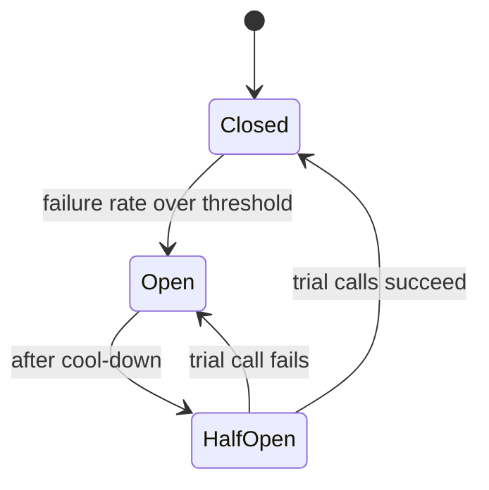

In a system of many services, something is always slow or down. These patterns stop one failure from becoming an outage.

## TL;DR

- Always set **timeouts**; an unbounded wait ties up threads.
- **Retry** only idempotent calls, with **exponential backoff and jitter** and a cap.
- A **circuit breaker** stops calling a failing dependency, then probes for recovery.
- **Bulkheads** isolate resources so one dependency cannot starve others.
- Provide a **fallback** or degrade gracefully.

## The idea in plain English

A fuse trips when current is too high so the house does not burn. A circuit breaker trips when a dependency keeps failing so your service does not pile up waiting.

## Core concepts

1. **Timeouts.** Shorter than the caller's own deadline; propagate deadlines downstream.
2. **Retries with backoff and jitter.** Delay doubles each attempt with randomness to avoid synchronized retries.
3. **Retry budget.** Limit retries to a fraction of traffic to avoid retry storms.
4. **Circuit states.** Closed (normal), open (fail fast), half-open (trial calls).
5. **Bulkhead.** Separate thread or connection pools per dependency.
6. **Fallbacks.** Cached data, default value, or a reduced feature.

## Architecture

## Deep dive

### Retry storms

If every layer retries three times, a failure multiplies load by 27 at the bottom. Retry at one layer, use budgets, and honour `Retry-After`.

### Graceful degradation

Recommendation service down? Show popular items from cache. Decide fallbacks in advance per feature.

## Trade-offs

| Choice | Gain | Cost |
|---|---|---|
| Aggressive retries | Hides blips | Amplifies outages |
| Low threshold breaker | Fast protection | False trips |

## Real-world examples

- Dependencies between services: [Uber Eats](/system-design/case-studies/uber-eats), [Netflix](/system-design/case-studies/netflix).
- Payment provider calls: [Kindle Payments](/system-design/case-studies/kindle-payments).
- Crawlers backing off failing hosts: [Web Crawler](/system-design/case-studies/web-crawler).

## Common pitfalls

- Retrying non-idempotent calls.
- Retries without jitter.
- No fallback when the circuit is open.
- Timeouts longer than the user's patience.

## How to answer in an interview

For each remote call, state timeout, retry policy, breaker and fallback, and mention idempotency.

## Related patterns

[Idempotency](/system-design/patterns/idempotency) · [Back Pressure](/system-design/patterns/back-pressure) · [Load Balancing](/system-design/patterns/load-balancing)

## Further reading

- [Timeouts, retries and backoff with jitter (AWS Builders' Library)](https://aws.amazon.com/builders-library/timeouts-retries-and-backoff-with-jitter/)
- [Circuit Breaker (Martin Fowler)](https://martinfowler.com/bliki/CircuitBreaker.html)

<InterviewQuestions>
  <InterviewQuestion question="Why add jitter to backoff?" category="Reliability" level="Mid">
    Without it, many clients retry at the same instants and re-overload the recovering service; randomness spreads the retries out.
  </InterviewQuestion>
  <InterviewQuestion question="Describe the circuit breaker states." category="Concepts" level="Junior">
    Closed passes calls; open rejects them immediately after too many failures; half-open lets a few trial calls through and closes if they succeed.
  </InterviewQuestion>
</InterviewQuestions>
