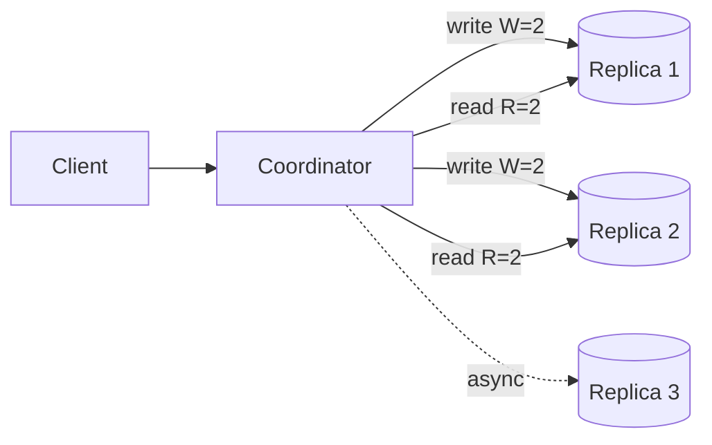

Once data is replicated, you must decide what a reader is allowed to see. This choice shapes latency, availability and complexity.

## TL;DR

- **CAP:** during a network partition you choose between consistency and availability.
- **PACELC:** even without partitions you trade latency against consistency.
- **Strong consistency:** reads see the latest write. **Eventual:** replicas converge over time. **Causal:** related events keep their order.
- **Quorums** (`R + W > N`) tune the trade-off per request.
- Choose **per feature**, not per company.

## The idea in plain English

A bank balance must be exact; a "likes" counter can lag a few seconds. Same system, different needs.

## Core concepts

1. **Strong (linearizable).** Behaves like one copy. Needs coordination, so it costs latency.
2. **Eventual.** Fast and available; readers may see stale data.
3. **Read-your-writes, monotonic reads.** Session guarantees that fix the worst surprises of eventual consistency.
4. **Causal.** If A caused B, everyone sees A before B.
5. **Quorum.** With `N` replicas, writing to `W` and reading from `R` with `R + W > N` guarantees overlap with the latest write.
6. **Conflict resolution.** Last-write-wins, vector clocks, or CRDTs when replicas accept concurrent writes.

## Architecture

## Deep dive

### Reading CAP correctly

Partitions happen, so the real choice is what to do during one. A CP system refuses some requests to stay correct; an AP system answers with possibly stale data and reconciles later.

### Replication styles

Single-leader gives simple ordering; multi-leader and leaderless boost availability and write locality but need conflict handling. See [Single Leader](/system-design/databases/single-leader-replication), [Leaderless](/system-design/databases/leaderless-replication) and [Replication Quorums](/system-design/databases/replication-quorums).

## Trade-offs

| Choice | Gain | Cost |
|---|---|---|
| Strong | Simple mental model | Latency, lower availability under partition |
| Eventual | Speed, availability | Stale reads, conflicts |

## Real-world examples

- Inventory and seats need strong guarantees: [Ticketmaster](/system-design-case-studies/case-studies/ticketmaster), [Hotel Booking](/system-design-case-studies/case-studies/hotel-booking).
- Dynamo-style tunable consistency: [Key Value Store](/system-design-case-studies/case-studies/key-value-store).
- Counters and feeds tolerate eventual consistency: [Twitter](/system-design-case-studies/case-studies/twitter), [Instagram](/system-design-case-studies/case-studies/instagram).
- Message ordering in chat: [WhatsApp](/system-design-case-studies/case-studies/whatsapp).

## Common pitfalls

- Saying "CAP says pick two" without mentioning partitions.
- Using strong consistency everywhere.
- Ignoring read-your-writes, which users notice immediately.

## How to answer in an interview

Classify each data type by how wrong it can be, pick a model for it, and say how you would achieve it (leader reads, quorums, session stickiness).

## Related patterns

[Sharding](/system-design/patterns/sharding) · [Leader Election and Consensus](/system-design/patterns/leader-election) · [Saga](/system-design/patterns/saga)

## Further reading

- [Consistency Tradeoffs in Modern Distributed Database System Design (Abadi)](https://www.cs.umd.edu/~abadi/papers/abadi-pacelc.pdf)
- [Jepsen consistency models](https://jepsen.io/consistency)

<InterviewQuestions>
  <InterviewQuestion question="Explain CAP in practice." category="Concepts" level="Mid">
    When a partition splits the replicas, you either reject some requests to remain consistent (CP) or serve possibly stale data to remain available (AP). Outside partitions you can have both, though PACELC notes the latency cost of consistency.
  </InterviewQuestion>
  <InterviewQuestion question="What does R + W > N guarantee?" category="Design" level="Senior">
    Read and write sets overlap in at least one replica, so a read includes the latest acknowledged write, provided conflicts and sloppy quorums are handled.
  </InterviewQuestion>
</InterviewQuestions>
