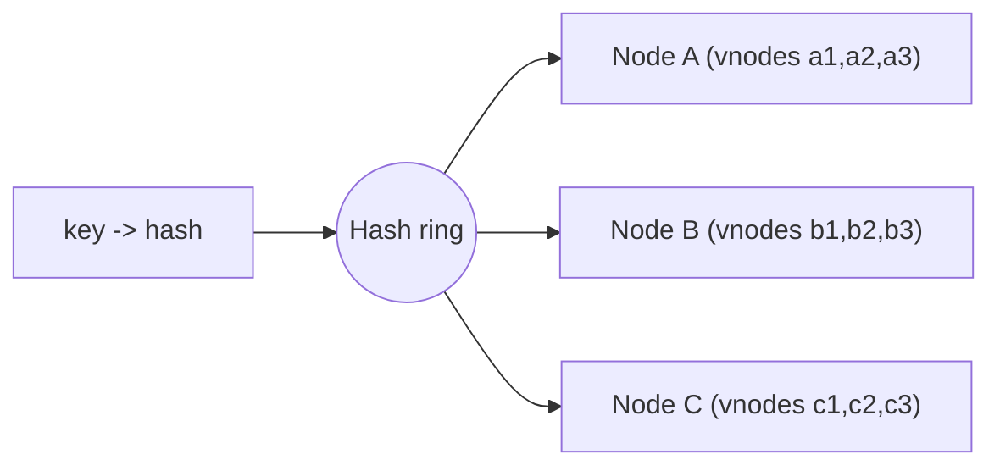

Consistent hashing is the standard answer to "how do you spread data or traffic across a changing set of nodes?" It underlies distributed caches, key-value stores and sharded databases.

## TL;DR

- Plain `hash(key) % N` remaps almost every key when `N` changes.
- Consistent hashing places nodes and keys on a **ring**; a key belongs to the next node clockwise.
- Adding or removing a node moves only about `1/N` of the keys.
- **Virtual nodes** give each machine many ring positions to even out load.
- Replication places copies on the next few distinct nodes on the ring.

## The idea in plain English

Imagine a clock face. Servers sit at points on it, and each key is hashed to a point and handed to the first server found going clockwise. If a server leaves, only its keys move to its neighbour; everything else stays put.

## Core concepts

1. **Hash ring.** Hash space (for example 0 to 2^32-1) bent into a circle.
2. **Key placement.** Hash the key, walk clockwise to the first node.
3. **Virtual nodes.** Each physical node owns many points, which smooths distribution and lets bigger machines take more points.
4. **Replication.** Store a key on the next `R` distinct nodes clockwise.
5. **Rebalancing.** A joining node takes over ranges from its successor; a leaving node hands ranges to its successor.
6. **Variants.** Rendezvous (highest random weight) hashing and jump hash solve the same problem with different trade-offs.

## Architecture

## Deep dive

### Adding a node

With `hash % N`, going from 4 to 5 nodes remaps about 80% of keys. With a ring and virtual nodes, the new node takes small slices from many existing nodes, moving about 20% in total, and each donor loses only a little.

### Hot spots

Hashing evens out key counts, not popularity. A viral key still lands on one node; combine with replication or key splitting.

## Trade-offs

| Choice | Gain | Cost |
|---|---|---|
| More vnodes | Even load | More metadata, slower membership changes |
| Ring lookup | Minimal data movement | Needs membership gossip or a coordinator |

## Real-world examples

- Dynamo-style stores partition keys on a ring: [Key Value Store](/system-design-case-studies/case-studies/key-value-store).
- Distributed caches shard keys across nodes: [URL Shortener](/system-design-case-studies/case-studies/url-shortener), [Typeahead](/system-design-case-studies/case-studies/typeahead).
- Message partitions and broker assignment: [Distributed Message Queue](/system-design-case-studies/case-studies/distributed-message-queue).
- Object stores place data across storage nodes: [S3](/system-design-case-studies/case-studies/s3).

## Common pitfalls

- Too few virtual nodes, giving lumpy load.
- Ignoring that rebalancing moves real data and takes time.
- Assuming it fixes hot keys.

## How to answer in an interview

Explain why modulo hashing breaks, draw the ring, add virtual nodes, then cover replication and what happens on node join and leave.

## Related patterns

[Sharding](/system-design/patterns/sharding) · [Caching](/system-design/patterns/caching) · [Leader Election and Consensus](/system-design/patterns/leader-election)

## Further reading

- [Consistent Hashing and Random Trees (Karger et al., 1997)](https://dl.acm.org/doi/10.1145/258533.258660)
- [Dynamo: Amazon's Highly Available Key-value Store](https://www.allthingsdistributed.com/files/amazon-dynamo-sosp2007.pdf)

<InterviewQuestions>
  <InterviewQuestion question="Why not use hash(key) % N?" category="Concepts" level="Junior">
    Changing N changes the result for almost every key, forcing a mass data move or a cache wipe. Consistent hashing limits movement to roughly 1/N of the keys.
  </InterviewQuestion>
  <InterviewQuestion question="What are virtual nodes for?" category="Concepts" level="Mid">
    They give each physical node many ring positions, so load evens out statistically and stronger machines can own more positions.
  </InterviewQuestion>
  <InterviewQuestion question="How are replicas chosen on the ring?" category="Architecture" level="Mid">
    Walk clockwise from the key's position and take the next R distinct physical nodes, skipping virtual nodes of the same machine, ideally across failure zones.
  </InterviewQuestion>
</InterviewQuestions>
