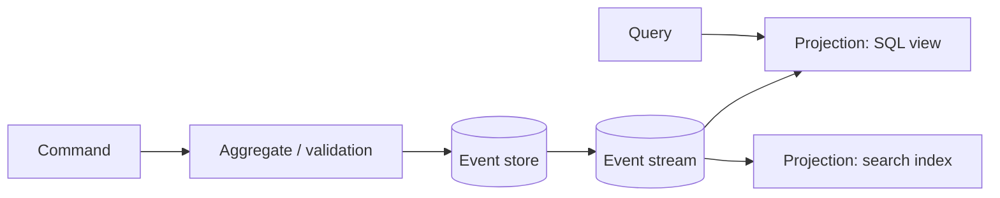

Some systems read and write in very different shapes, or need a full audit trail. CQRS and event sourcing address those cases, at a real cost in complexity.

## TL;DR

- **CQRS:** use one model for commands (writes) and another for queries (reads).
- **Event sourcing:** store every state change as an immutable event; current state is a replay.
- Read models are **projections**, usually eventually consistent.
- Gives audit, replay and tailored read stores; adds complexity.
- Use selectively, not by default.

## The idea in plain English

A bank keeps a ledger of transactions (events). Your balance is a summary computed from the ledger and cached on a statement (a read model).

## Core concepts

1. **Command side.** Validates and appends events.
2. **Event store.** Append-only, ordered per aggregate.
3. **Projections.** Consumers build read-optimised views (SQL tables, search indexes, caches).
4. **Snapshots.** Periodic state checkpoints so replay stays fast.
5. **Replay.** Rebuild or add a new read model from history.
6. **Schema evolution.** Events live forever, so version them carefully.

## Architecture

## Deep dive

### Eventual consistency in the UI

After a command the read model may lag. Return the new state from the command response, or poll until the version appears.

### When not to use it

Simple CRUD with no audit or replay needs does not benefit; the extra moving parts cost more than they save.

## Trade-offs

| Choice | Gain | Cost |
|---|---|---|
| CQRS | Independent scaling and shapes | Sync lag, more components |
| Event sourcing | Audit, replay, new views | Versioning, learning curve |

## Real-world examples

- Ledgers and payments: [Kindle Payments](/system-design/case-studies/kindle-payments).
- Search and read-optimised views next to a primary store: [Typeahead](/system-design/case-studies/typeahead), [Zillow](/system-design/case-studies/zillow).
- Log-centric telemetry: [Metrics and Logging](/system-design/case-studies/metrics-and-logging).

## Common pitfalls

- Applying it to every service.
- Unversioned events.
- Projections that cannot be rebuilt.

## How to answer in an interview

Justify it with an audit or read/write mismatch need, show the write path, the stream and projections, and explain lag handling.

## Related patterns

[Message Queues](/system-design/patterns/message-queues) · [Saga](/system-design/patterns/saga) · [Consistency Models](/system-design/patterns/consistency-models) · [Polyglot Persistence](/system-design/databases/polyglot-persistence) · [Analytical Databases](/system-design/databases/analytical-databases)

## Further reading

- [CQRS (Martin Fowler)](https://martinfowler.com/bliki/CQRS.html)
- [Event Sourcing (Martin Fowler)](https://martinfowler.com/eaaDev/EventSourcing.html)

<InterviewQuestions>
  <InterviewQuestion question="What problem does CQRS solve?" category="Concepts" level="Mid">
    It lets reads and writes use different models and stores, so each can be optimised and scaled independently, at the cost of eventual consistency between them.
  </InterviewQuestion>
  <InterviewQuestion question="How do snapshots help event sourcing?" category="Design" level="Senior">
    Replaying a long history is slow; a snapshot stores state at a version so you replay only newer events.
  </InterviewQuestion>
</InterviewQuestions>
