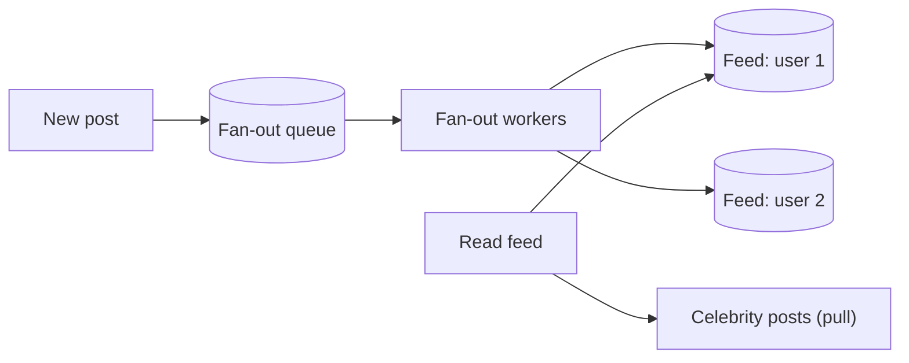

Every feed, notification and chat group raises the same question: when someone posts, do you do the work now for all followers, or later when each follower reads?

## TL;DR

- **Fan-out on write (push):** copy the post into each follower's feed at write time. Reads are fast; writes are expensive.
- **Fan-out on read (pull):** assemble the feed when the user opens it. Writes are cheap; reads are expensive.
- **Hybrid:** push for normal users, pull for celebrities.
- Feeds are stored as lists of ids in a cache, with content fetched separately.

## The idea in plain English

A newspaper either delivers a copy to every subscriber's door (push) or leaves papers at the kiosk for people to collect (pull). Delivering to ten million doors for one big story is costly; for a small town it is perfect.

## Core concepts

1. **Feed store.** Per-user list of post ids (for example a Redis list or sorted set).
2. **Push cost.** Writes scale with follower count.
3. **Pull cost.** Reads scale with followees and need merging and ranking.
4. **Hybrid threshold.** Users above a follower count are skipped at write time and merged in at read time.
5. **Async workers.** Fan-out runs through a [queue](/system-design/patterns/message-queues) so the post call returns quickly.

## Architecture

## Deep dive

### Why hybrid wins

Push makes reads a single cache fetch, which matters because reads dominate. But one account with 50 million followers would need 50 million writes per post. Skipping those accounts and merging their recent posts at read time bounds the write cost.

### Notifications

The same split applies to push notifications: fan out through a queue, rate limit per user, and deduplicate.

## Trade-offs

| Choice | Gain | Cost |
|---|---|---|
| Push | Fast reads | Write amplification, wasted work for inactive users |
| Pull | Cheap writes | Slow, heavy reads |
| Hybrid | Balanced | More moving parts |

## Real-world examples

- [Twitter](/system-design/case-studies/twitter): the classic hybrid timeline.
- [Instagram](/system-design/case-studies/instagram) and [TikTok](/system-design/case-studies/tiktok): feeds and recommendation merge.
- [WhatsApp](/system-design/case-studies/whatsapp) and [Facebook Messenger](/system-design/case-studies/facebook-messenger): group message delivery.

## Common pitfalls

- Fanning out to inactive users.
- Storing full post bodies in every feed instead of ids.
- Synchronous fan-out in the request path.
- Not handling deletes and edits after fan-out.

## How to answer in an interview

State read/write ratio and follower distribution, pick push, pull or hybrid with a threshold, and describe the feed store and async workers.

## Related patterns

[Message Queues](/system-design/patterns/message-queues) · [Caching](/system-design/patterns/caching) · [Back Pressure](/system-design/patterns/back-pressure)

## Further reading

- [Timelines at Scale (Twitter, InfoQ)](https://www.infoq.com/presentations/Twitter-Timeline-Scalability/)
- [Feeding Frenzy: Selectively Materializing Users' Event Feeds](https://dl.acm.org/doi/10.1145/1807167.1807257)

<InterviewQuestions>
  <InterviewQuestion question="Push or pull for a news feed?" category="Design" level="Mid">
    Reads outnumber writes, so push gives fast reads for most users, but celebrity accounts make push too expensive. A hybrid pushes for normal users and pulls celebrity posts at read time.
  </InterviewQuestion>
  <InterviewQuestion question="How do you handle a post deleted after fan-out?" category="Consistency" level="Senior">
    Feeds store ids, so filter at read time against a deleted flag or tombstone, and clean feeds lazily in the background.
  </InterviewQuestion>
</InterviewQuestions>
