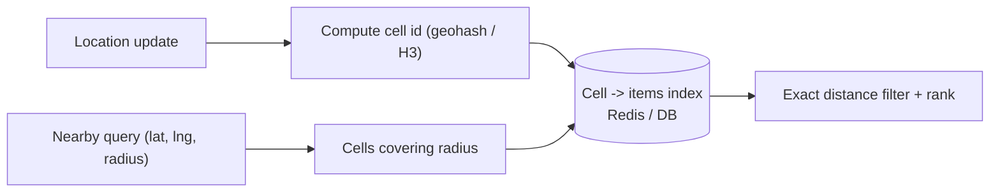

"Find drivers, restaurants or listings near me" cannot use a normal index on latitude and longitude. Geospatial indexes turn 2D proximity into something a database can search.

## TL;DR

- Plain `lat` and `lng` indexes cannot answer radius queries efficiently.
- **Geohash** maps a location to a string; shared prefix means nearby.
- **Quadtree** recursively splits dense areas; **R-tree** indexes bounding boxes.
- **S2 / H3** divide the globe into hierarchical cells.
- Search the target cell **and its neighbours**, then filter by exact distance.

## The idea in plain English

Divide a map into a grid, label each square, and put each person in a square. To find who is near you, look in your square and the eight around it, then measure real distances.

## Core concepts

1. **Geohash.** Interleaves latitude and longitude bits and base32-encodes them; longer string, smaller cell. Edge case: neighbours across cell boundaries have different prefixes.
2. **Quadtree.** A node splits into four when it holds too many points; adapts to density.
3. **R-tree.** Groups nearby objects in nested bounding rectangles; supports shapes and ranges. See [R-Tree](/system-design/databases/r-tree).
4. **S2 / H3.** Hierarchical cell systems; H3 uses hexagons with uniform neighbour distance.
5. **Query flow.** Compute cells covering the radius, fetch candidates, filter by distance, rank.
6. **Moving objects.** Frequent updates favour in-memory grids or cells with TTL over rebuilding trees.

## Architecture

## Deep dive

### Choosing the cell size

Pick a resolution where a typical query touches a handful of cells with a manageable number of items each. Dense cities may need finer cells than rural areas; quadtrees adapt automatically.

### Sharding by region

Shard by cell prefix, but beware of hot cities. Combine with replicas for read-heavy search.

## Trade-offs

| Choice | Gain | Cost |
|---|---|---|
| Geohash | Simple, works with any DB | Boundary issues, uneven cells |
| Quadtree | Adapts to density | In-memory, harder to distribute |
| H3 / S2 | Uniform cells, hierarchy | Library dependency |

## Real-world examples

- Routing and place search: [Google Maps](/system-design-case-studies/case-studies/google-maps).
- Nearby restaurants and couriers: [Uber Eats](/system-design-case-studies/case-studies/uber-eats).
- Nearby matches: [Tinder](/system-design-case-studies/case-studies/tinder).
- Property search by map area: [Zillow](/system-design-case-studies/case-studies/zillow).
- Finding the right lot or place: [Parking Garage](/system-design-case-studies/case-studies/parking-garage).

## Common pitfalls

- Forgetting neighbouring cells.
- Using straight-line distance when travel time matters.
- Writing every location ping to a durable database.
- Hot shards in dense cities.

## How to answer in an interview

Pick a cell scheme, explain the index and query flow including neighbours, handle location updates, and say how you rank (distance, ETA).

## Related patterns

[Sharding](/system-design/patterns/sharding) · [Caching](/system-design/patterns/caching) · [Consistent Hashing](/system-design/patterns/consistent-hashing) · [R-Tree](/system-design/databases/r-tree) · [Search Engines](/system-design/databases/search-engines)

## Further reading

- [H3: Uber's Hexagonal Hierarchical Spatial Index](https://www.uber.com/blog/h3/)
- [S2 Geometry](http://s2geometry.io/)

<InterviewQuestions>
  <InterviewQuestion question="Why not index latitude and longitude separately?" category="Concepts" level="Junior">
    Each index narrows one dimension only, returning a huge strip of candidates. Spatial indexes preserve 2D locality so one lookup finds nearby points.
  </InterviewQuestion>
  <InterviewQuestion question="Geohash vs quadtree?" category="Trade-offs" level="Mid">
    Geohash is a string key that works with any key-value store but has fixed-size cells and boundary quirks; a quadtree adapts to density and is usually kept in memory.
  </InterviewQuestion>
  <InterviewQuestion question="How do you handle millions of moving drivers?" category="Design" level="Senior">
    Keep current positions in an in-memory store keyed by cell with short TTLs, update on pings, query neighbouring cells, and persist only periodic snapshots or trips.
  </InterviewQuestion>
</InterviewQuestions>
