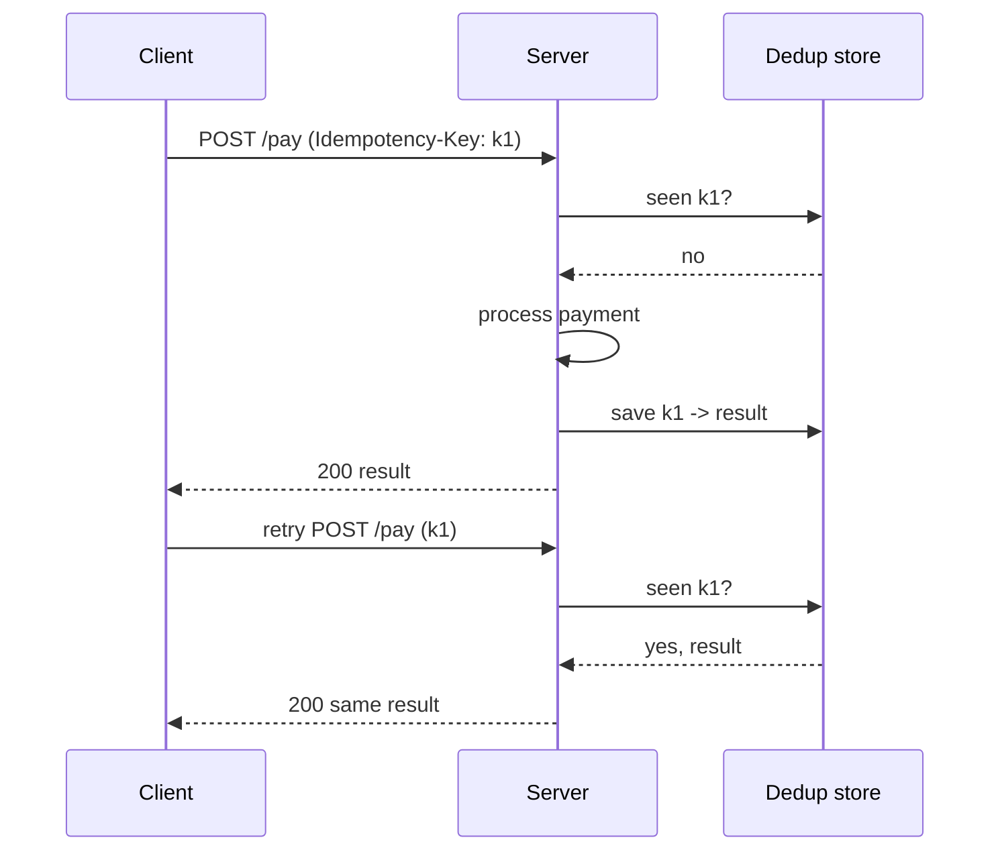

Networks time out, clients retry, brokers redeliver. Idempotency is what stops a retry from charging a card twice.

## TL;DR

- An operation is **idempotent** if doing it many times has the same effect as doing it once.
- `GET`, `PUT` and `DELETE` are naturally idempotent; `POST` is not.
- Use an **idempotency key** chosen by the client and stored with the result.
- Consumers of at-least-once queues must **deduplicate**.
- Conditional writes and unique constraints enforce it in the database.

## The idea in plain English

Pressing an elevator button five times still calls one elevator. A well-designed API behaves the same when a request is repeated.

## Core concepts

1. **Idempotency key.** A unique id (UUID) sent in a header; the server stores key and response.
2. **Dedup store.** Table or cache of processed keys with a TTL.
3. **Unique constraints.** Insert fails on a duplicate key, making the second attempt a no-op.
4. **Conditional updates.** `UPDATE ... WHERE version = n` or compare-and-set.
5. **Natural idempotency.** Set a state (`status = paid`) rather than apply a delta (`balance += 10`).

## Architecture

## Deep dive

### Races

Two concurrent requests with the same key must not both run. Reserve the key first (insert with a unique constraint or atomic set-if-absent) in a "processing" state, then complete it.

### Scope and expiry

Keys are scoped per user and endpoint, and kept long enough to cover realistic retry windows (hours to days for payments).

## Trade-offs

| Choice | Gain | Cost |
|---|---|---|
| Key store | Safe retries | Extra storage and a lookup per request |
| Long retention | Covers late retries | More storage |

## Real-world examples

- [Kindle Payments](/system-design/case-studies/kindle-payments) and [Uber Eats](/system-design/case-studies/uber-eats): payments and orders.
- [Hotel Booking](/system-design/case-studies/hotel-booking) and [Ticketmaster](/system-design/case-studies/ticketmaster): avoiding double booking.
- [Distributed Message Queue](/system-design/case-studies/distributed-message-queue): consumer-side dedup.

## Common pitfalls

- Generating the key on the server (it must come from the client).
- Check-then-act without atomicity.
- Returning an error for a duplicate instead of the original result.
- Forgetting side effects such as emails.

## How to answer in an interview

Identify which operations are retried, add client-generated keys, store results atomically, and mention expiry and concurrent duplicates.

## Related patterns

[Message Queues](/system-design/patterns/message-queues) · [Saga](/system-design/patterns/saga) · [Circuit Breaker and Retries](/system-design/patterns/circuit-breaker-and-retries)

## Further reading

- [Designing robust and predictable APIs with idempotency (Stripe)](https://stripe.com/blog/idempotency)
- [Making retries safe with idempotent APIs (AWS Builders' Library)](https://aws.amazon.com/builders-library/making-retries-safe-with-idempotent-APIs/)

<InterviewQuestions>
  <InterviewQuestion question="How do you make a payment API idempotent?" category="Design" level="Mid">
    Require a client-generated idempotency key, atomically reserve it, process once, store the response, and return the stored response for repeats.
  </InterviewQuestion>
  <InterviewQuestion question="Why is idempotency needed with at-least-once queues?" category="Concepts" level="Mid">
    Redelivery means a handler may see the same message twice; without deduplication the side effect would be applied twice.
  </InterviewQuestion>
</InterviewQuestions>
