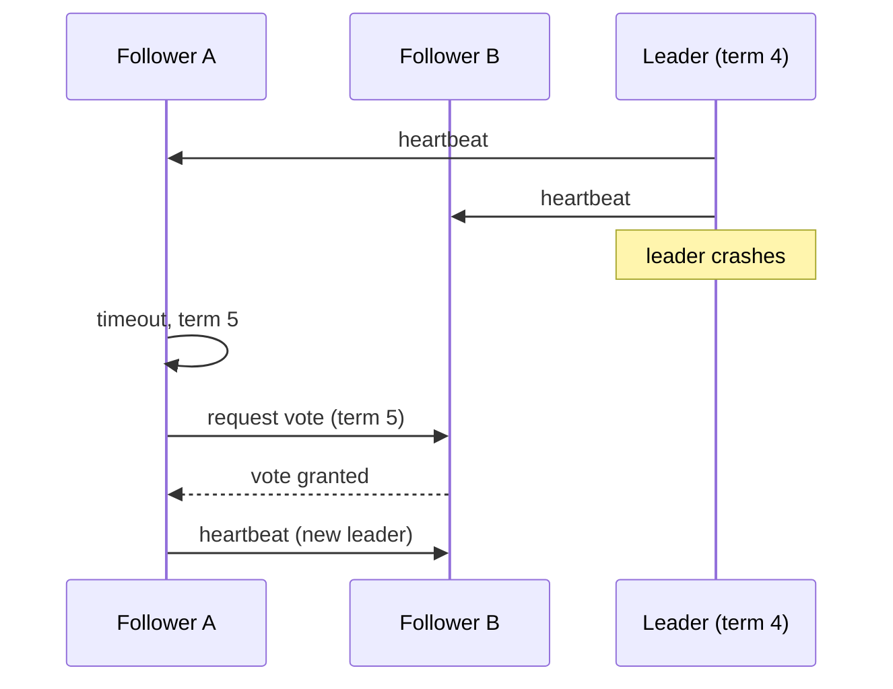

Many designs need exactly one node in charge: the primary of a database, the owner of a partition, the scheduler. Doing this safely is a consensus problem.

## TL;DR

- A **leader** serialises decisions; **followers** replicate and take over on failure.
- **Consensus** (Raft, Paxos, ZAB) lets nodes agree on a value or leader despite failures, using a **majority quorum**.
- Detect failure with **heartbeats** and **timeouts**; elect a new leader with a higher **term/epoch**.
- **Split brain** (two leaders) is prevented by quorums and **fencing tokens**.
- Usually you use a coordination service (etcd, ZooKeeper) instead of writing consensus yourself.

## The idea in plain English

A meeting needs one chair. If the chair leaves, the group votes on a new one, and a chair is only valid if a majority backs them. Someone who slept through the vote and still thinks they are chair must be ignored.

## Core concepts

1. **Quorum.** A majority (`N/2 + 1`) must agree; any two majorities overlap, so two leaders cannot both be committed.
2. **Terms / epochs.** Monotonic numbers; the higher term wins.
3. **Heartbeats and timeouts.** Followers start an election if the leader goes silent (randomised timeouts avoid ties).
4. **Log replication.** The leader appends entries and commits once a majority stores them.
5. **Leases.** A leader holds authority for a time window and must renew; relies on bounded clock drift.
6. **Fencing tokens.** Each leadership gets an increasing token; storage rejects writes with an older token, stopping a paused ex-leader.

## Architecture

## Deep dive

### Split brain and fencing

A leader that pauses (GC, network) may wake up believing it is still leader. A lease alone is not enough; the resource it writes to must check the fencing token and refuse stale ones.

### Why odd cluster sizes

3 nodes tolerate 1 failure, 5 tolerate 2. Even sizes add cost without extra tolerance.

## Trade-offs

| Choice | Gain | Cost |
|---|---|---|
| Consensus | Safety under failures | Latency of quorum round trips, availability needs a majority |
| Single leader | Simple ordering | Write bottleneck, failover pause |
| Leases | Cheap reads on leader | Depends on clocks |

## Real-world examples

- Partition leaders and controller election: [Distributed Message Queue](/system-design-case-studies/case-studies/distributed-message-queue).
- Metadata and replica coordination: [Key Value Store](/system-design-case-studies/case-studies/key-value-store), [S3](/system-design-case-studies/case-studies/s3).
- Single-leader replication: [Single Leader Replication](/system-design/databases/single-leader-replication).

## Common pitfalls

- Using a database row or Redis key as a lock without fencing.
- Assuming clocks are synchronised.
- Even-sized clusters or clusters spread so a zone loss loses the majority.
- Writing your own consensus.

## How to answer in an interview

Say why you need a single writer, use an existing coordination service, explain quorums, terms and failover time, and mention fencing for external resources.

## Related patterns

[Consistency Models](/system-design/patterns/consistency-models) · [Consistent Hashing](/system-design/patterns/consistent-hashing) · [Sharding](/system-design/patterns/sharding)

## Further reading

- [In Search of an Understandable Consensus Algorithm (Raft)](https://raft.github.io/raft.pdf)
- [How to do distributed locking (Kleppmann)](https://martin.kleppmann.com/2016/02/08/how-to-do-distributed-locking.html)

<InterviewQuestions>
  <InterviewQuestion question="How does Raft elect a leader?" category="Concepts" level="Mid">
    A follower whose election timeout fires becomes a candidate, increments the term and requests votes; a node grants one vote per term, and a candidate with a majority becomes leader and sends heartbeats. Randomised timeouts make split votes rare.
  </InterviewQuestion>
  <InterviewQuestion question="What is a fencing token?" category="Reliability" level="Senior">
    A number that increases with each leadership or lock grant. The protected resource rejects any request carrying a lower token, so a paused former leader cannot corrupt data.
  </InterviewQuestion>
  <InterviewQuestion question="Why does consensus need a majority?" category="Concepts" level="Mid">
    Any two majorities share at least one node, so a decision committed by one majority is seen by any later majority, preventing two conflicting leaders or values.
  </InterviewQuestion>
</InterviewQuestions>
