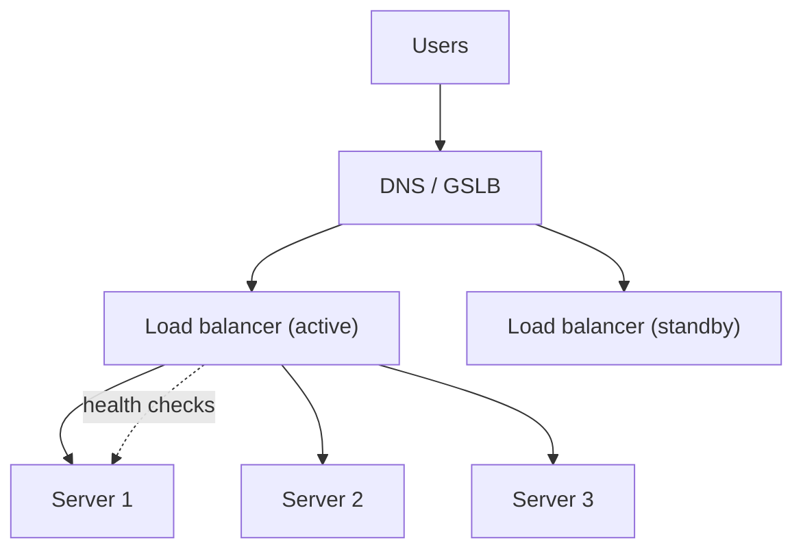

A load balancer is on almost every architecture diagram. Interviewers want to hear how traffic is spread, how failures are detected, and how the balancer itself avoids being a single point of failure.

## TL;DR

- A load balancer distributes requests over healthy servers to raise capacity and availability.
- **L4** balances on IP and port (fast, simple); **L7** reads HTTP and can route by path, header or cookie.
- Common algorithms: **round robin**, **least connections**, **weighted**, **consistent hashing**.
- **Health checks** remove bad servers; **redundant balancers** remove the single point of failure.
- Keep servers **stateless** so any server can handle any request.

## The idea in plain English

A shop with many checkout lanes needs someone directing customers to the shortest open lane and closing broken ones. The load balancer is that person for requests.

## Core concepts

1. **L4 vs L7.** L4 forwards TCP/UDP connections without inspecting content. L7 terminates HTTP, enabling routing rules, TLS termination, caching and auth.
2. **Algorithms.** Round robin is even for similar requests; least connections adapts to uneven request cost; weighted variants handle different server sizes; hashing keeps a key on the same server.
3. **Health checks.** Active probes (ping an endpoint) and passive checks (watch error rates) take servers in and out of rotation.
4. **Sticky sessions.** Pin a client to a server; avoid by storing session state in a shared store.
5. **Global load balancing.** DNS or anycast sends users to the nearest region and fails over between regions.
6. **Client-side balancing.** Service meshes and clients pick a server themselves, avoiding an extra hop.

## Architecture

## Deep dive

### Making the balancer itself reliable

Run balancers in pairs (active-passive with a floating IP, or active-active behind anycast or DNS). Managed balancers (ALB, NLB) do this for you.

### Connection draining

Before removing a server for deploys, stop sending new requests and let in-flight ones finish. This avoids dropped requests during rollouts.

## Trade-offs

| Choice | Gain | Cost |
|---|---|---|
| L4 | Speed, protocol-agnostic | No content-based routing |
| L7 | Smart routing, TLS, auth | More CPU, more latency |
| Sticky sessions | Simple stateful apps | Uneven load, harder failover |

## Real-world examples

- Connection-heavy chat servers rely on balancing plus sticky connections: [WhatsApp](/system-design-case-studies/case-studies/whatsapp), [Facebook Messenger](/system-design-case-studies/case-studies/facebook-messenger).
- Streaming traffic is steered to the nearest edge: [Netflix](/system-design-case-studies/case-studies/netflix).
- Model-serving fleets balance by queue depth: [ChatGPT](/system-design-case-studies/case-studies/chatgpt).

## Common pitfalls

- Balancer as a single point of failure.
- Health checks that only test "process is up", not "can serve traffic".
- Round robin with very uneven request cost.
- Forgetting connection draining on deploys.

## How to answer in an interview

Place balancers at each tier boundary, choose L4 or L7 with a reason, name the algorithm, describe health checks, and mention redundancy and multi-region failover.

## Related patterns

[Consistent Hashing](/system-design/patterns/consistent-hashing) · [Circuit Breaker and Retries](/system-design/patterns/circuit-breaker-and-retries) · [Rate Limiting](/system-design/patterns/rate-limiting)

## Further reading

- [Load balancing in the datacenter (Google SRE Book)](https://sre.google/sre-book/load-balancing-datacenter/)
- [Maglev: A Fast and Reliable Software Network Load Balancer](https://research.google/pubs/maglev-a-fast-and-reliable-software-network-load-balancer/)

<InterviewQuestions>
  <InterviewQuestion question="L4 vs L7 load balancer?" category="Concepts" level="Junior">
    L4 routes connections by IP and port and is very fast. L7 understands HTTP, so it can route by URL or header, terminate TLS and apply auth, at higher cost.
  </InterviewQuestion>
  <InterviewQuestion question="How do you avoid the load balancer being a single point of failure?" category="Reliability" level="Mid">
    Run at least two balancers in active-passive or active-active mode using a floating IP, anycast or DNS, and use managed balancers that are redundant across zones.
  </InterviewQuestion>
  <InterviewQuestion question="Why avoid sticky sessions?" category="Trade-offs" level="Mid">
    They create uneven load and lose state when the pinned server dies. Keeping sessions in a shared store such as Redis lets any server serve any request.
  </InterviewQuestion>
</InterviewQuestions>
