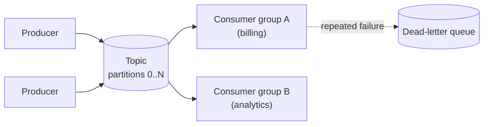

Queues turn spikes into smooth work and let services fail independently. They are the backbone of asynchronous designs.

## TL;DR

- A **queue** delivers each message to one consumer; **pub/sub** delivers it to every subscriber.
- Producers and consumers scale and fail independently; the queue absorbs bursts.
- Delivery is **at-most-once**, **at-least-once** or (with effort) **effectively exactly-once**.
- Ordering is usually guaranteed only **within a partition**.
- Use **retries with backoff**, a **dead-letter queue**, and **idempotent consumers**.

## The idea in plain English

A restaurant ticket rail: waiters add tickets, cooks take them as they have capacity. The waiter does not wait for the dish, and a busy night just means a longer rail.

## Core concepts

1. **Producer, broker, consumer.** The broker stores messages durably until acknowledged.
2. **Queue vs topic.** Competing consumers share a queue; each subscriber group gets its own copy of a topic.
3. **Partitions.** A topic is split into ordered logs; the partition key preserves per-key order and sets parallelism.
4. **Acknowledgements.** Consumers ack after processing; unacked messages are redelivered.
5. **Delivery semantics.** At-least-once is the practical default; pair it with [idempotency](/system-design/patterns/idempotency).
6. **Dead-letter queue.** Messages that keep failing are parked for inspection.
7. **Log vs queue brokers.** Log-based (Kafka) retain and replay; queue-based (SQS, RabbitMQ) delete on ack.

## Architecture

## Deep dive

### Outbox pattern

To update a database and publish an event atomically, write the event to an outbox table in the same transaction, and have a relay publish it. This avoids losing events or publishing ones for rolled-back changes.

### Back pressure

If consumers fall behind, lag grows. Scale consumers, cap queue depth, or shed load; see [Back Pressure](/system-design/patterns/back-pressure).

## Trade-offs

| Choice | Gain | Cost |
|---|---|---|
| Async via queue | Decoupling, burst absorption | Eventual consistency, harder debugging |
| Strict ordering | Predictable processing | Limits parallelism |
| Exactly-once | No duplicates | Complexity, throughput cost |

## Real-world examples

- Designing the broker itself: [Distributed Message Queue](/system-design/case-studies/distributed-message-queue).
- Fan-out of posts and notifications: [Twitter](/system-design/case-studies/twitter), [Instagram](/system-design/case-studies/instagram).
- Crawl frontier and processing stages: [Web Crawler](/system-design/case-studies/web-crawler).
- Video transcoding pipelines: [YouTube](/system-design/case-studies/youtube), [TikTok](/system-design/case-studies/tiktok).
- Payments and orders: [Uber Eats](/system-design/case-studies/uber-eats), [Kindle Payments](/system-design/case-studies/kindle-payments).
- Export jobs: [User Data Export](/system-design/case-studies/user-data-export).

## Common pitfalls

- Assuming exactly-once delivery without idempotent handlers.
- Poison messages blocking a partition.
- Unbounded queues hiding an overloaded consumer.
- Using one hot partition key.

## How to answer in an interview

Say what must be synchronous and what can be async, choose queue or topic, state delivery semantics and ordering needs, and cover retries, DLQ and lag monitoring.

## Related patterns

[Idempotency](/system-design/patterns/idempotency) · [Back Pressure](/system-design/patterns/back-pressure) · [Saga](/system-design/patterns/saga) · [Fan-out](/system-design/patterns/fan-out)

## Further reading

- [Kafka: a Distributed Messaging System for Log Processing](https://notes.stephenholiday.com/Kafka.pdf)
- [Transactional Outbox pattern (microservices.io)](https://microservices.io/patterns/data/transactional-outbox.html)

<InterviewQuestions>
  <InterviewQuestion question="Can you get exactly-once delivery?" category="Concepts" level="Senior">
    Not strictly over an unreliable network. In practice you use at-least-once delivery plus idempotent processing or transactional writes to get an effectively-once outcome.
  </InterviewQuestion>
  <InterviewQuestion question="How is ordering preserved?" category="Design" level="Mid">
    Route related messages to the same partition with a key; order is guaranteed within a partition, and one consumer per partition processes it sequentially.
  </InterviewQuestion>
  <InterviewQuestion question="What is a dead-letter queue?" category="Reliability" level="Junior">
    A holding queue for messages that failed after the allowed retries, so they stop blocking the main flow and can be examined or replayed.
  </InterviewQuestion>
</InterviewQuestions>
