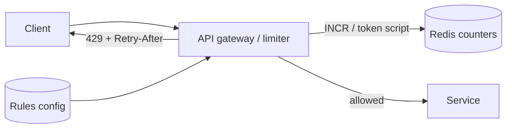

Rate limiting protects services from abuse, bugs and bursts, and enforces fair use and pricing tiers.

## TL;DR

- Limit requests per **identity** (user, API key, IP) over a **window**.
- Algorithms: **fixed window**, **sliding window**, **token bucket**, **leaky bucket**.
- Token bucket is the common default: allows bursts, enforces an average.
- Distributed limiting needs a shared counter (Redis with atomic scripts) or local approximations.
- Respond `429 Too Many Requests` with `Retry-After` and rate-limit headers.

## The idea in plain English

A bucket gains one token per second up to a maximum. Each request spends a token; no tokens, no service. Idle users build up a small burst allowance.

## Core concepts

1. **Fixed window counter.** Count per minute. Simple, but allows 2x bursts at window edges.
2. **Sliding window log / counter.** Accurate, costs more memory (log) or approximates (counter).
3. **Token bucket.** Capacity and refill rate; cheap (two numbers per key).
4. **Leaky bucket.** Requests drain at a constant rate; smooths output.
5. **Where to enforce.** Gateway, service middleware, or both.
6. **Limit keys and tiers.** Per user, per endpoint, per tenant; different limits for free and paid.
7. **Distributed state.** Central store, sticky routing, or per-node quota slices that sync periodically.

## Architecture

## Deep dive

### Atomicity in Redis

Read-modify-write races let bursts through. Use a single Lua script (or `INCR` with `EXPIRE`) so check and update are atomic.

### Failure mode

If the limiter store is down, **fail open** (allow) for availability or **fail closed** for protection. Decide per endpoint; payments might fail closed, reads open.

## Trade-offs

| Choice | Gain | Cost |
|---|---|---|
| Central counter | Accurate | Extra hop, single dependency |
| Local counters | Fast, resilient | Approximate limits |
| Token bucket | Bursts allowed | Slightly more state than fixed window |

## Real-world examples

- The full design: [Rate Limiter](/system-design/case-studies/rate-limiter).
- Per-key API limits: [URL Shortener](/system-design/case-studies/url-shortener).
- Per-user and per-host limits: [Web Crawler](/system-design/case-studies/web-crawler).
- Per-user quotas for model calls: [ChatGPT](/system-design/case-studies/chatgpt).

## Common pitfalls

- Limiting by IP only (shared NATs, spoofing).
- Non-atomic counter updates.
- No rate-limit headers, so clients cannot back off.
- Retrying clients without jitter after a 429.

## How to answer in an interview

Choose the key and algorithm, say where it runs and where state lives, handle atomicity and store failure, and describe the client-facing response.

## Related patterns

[Back Pressure](/system-design/patterns/back-pressure) · [Load Balancing](/system-design/patterns/load-balancing) · [Caching](/system-design/patterns/caching)

## Further reading

- [Stripe: Scaling your API with rate limiters](https://stripe.com/blog/rate-limiters)
- [Token bucket (Wikipedia)](https://en.wikipedia.org/wiki/Token_bucket)

<InterviewQuestions>
  <InterviewQuestion question="Token bucket vs fixed window?" category="Concepts" level="Junior">
    Token bucket allows controlled bursts and smooths the rate; fixed window is simpler but can allow double the limit across a window boundary.
  </InterviewQuestion>
  <InterviewQuestion question="How do you rate limit across many servers?" category="Design" level="Mid">
    Keep counters in a shared store such as Redis using atomic operations, or give each node a slice of the quota and reconcile periodically when slight inaccuracy is acceptable.
  </InterviewQuestion>
  <InterviewQuestion question="What happens if the limiter's store fails?" category="Reliability" level="Senior">
    Choose fail-open or fail-closed per endpoint: open keeps the product available but unprotected, closed protects backends but rejects legitimate traffic. Often add a local fallback limiter.
  </InterviewQuestion>
</InterviewQuestions>
