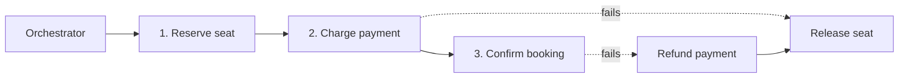

A booking touches inventory, payment and notifications, each in its own service and database. Sagas keep that workflow correct without a global lock.

## TL;DR

- A **saga** is a sequence of local transactions; if one fails, earlier steps are undone by **compensating actions**.
- Two styles: **choreography** (services react to events) and **orchestration** (a coordinator drives steps).
- **Two-phase commit** gives atomicity but blocks and scales poorly.
- Steps and compensations must be **idempotent** and retryable.
- Use **reservations with expiry** for scarce resources.

## The idea in plain English

Booking a trip: reserve the flight, then the hotel. If the hotel fails, cancel the flight. You never held a lock on both at once; you undid the first step.

## Core concepts

1. **Local transaction.** Each service commits to its own database.
2. **Compensation.** A business-level undo (refund, release hold), not a database rollback.
3. **Orchestrator.** A state machine that calls steps and compensations in order and persists progress.
4. **Choreography.** Services publish events; others subscribe. Simple for small flows, hard to follow at scale.
5. **Pivot and retryable steps.** Steps before the pivot are compensatable; after it, they must succeed through retries.
6. **Semantic locks.** Mark a record "pending" so others do not act on it mid-saga.

## Architecture

## Deep dive

### Reservation with expiry

Hold the seat or room for a few minutes. Payment success confirms it; failure or timeout releases it automatically, which avoids stuck state when a service crashes.

### Reliability

Persist saga state and use the [outbox pattern](/system-design/patterns/message-queues) so events are not lost between the database write and the publish.

## Trade-offs

| Choice | Gain | Cost |
|---|---|---|
| Saga | Scales, no distributed locks | Temporary inconsistency, compensation logic |
| 2PC | Atomic | Blocking, coordinator failure risk |
| Orchestration | Clear flow | Central component to run |

## Real-world examples

- [Ticketmaster](/system-design-case-studies/case-studies/ticketmaster) and [Hotel Booking](/system-design-case-studies/case-studies/hotel-booking): hold, pay, confirm.
- [Uber Eats](/system-design-case-studies/case-studies/uber-eats): order, restaurant, courier, payment.
- [Kindle Payments](/system-design-case-studies/case-studies/kindle-payments): purchase and entitlement.

## Common pitfalls

- Compensations that can fail with no retry.
- Non-idempotent steps.
- No timeout on pending states.
- Ignoring that users can observe intermediate states.

## How to answer in an interview

List the steps, define a compensation for each, choose orchestration or choreography, and explain how you handle crashes mid-flow.

## Related patterns

[Idempotency](/system-design/patterns/idempotency) · [Message Queues](/system-design/patterns/message-queues) · [CQRS and Event Sourcing](/system-design/patterns/cqrs-event-sourcing)

## Further reading

- [Sagas (Garcia-Molina and Salem, 1987)](https://www.cs.cornell.edu/andru/cs711/2002fa/reading/sagas.pdf)
- [Saga pattern (microservices.io)](https://microservices.io/patterns/data/saga.html)

<InterviewQuestions>
  <InterviewQuestion question="Why not use two-phase commit across microservices?" category="Concepts" level="Mid">
    It blocks participants while waiting for the coordinator, hurts availability and throughput, and is unsupported by many stores. Sagas trade atomicity for availability by using compensations.
  </InterviewQuestion>
  <InterviewQuestion question="Orchestration or choreography?" category="Design" level="Senior">
    Choreography fits short flows with few services; orchestration is better for long or branching flows because the logic and state live in one place that is easier to monitor and change.
  </InterviewQuestion>
</InterviewQuestions>
