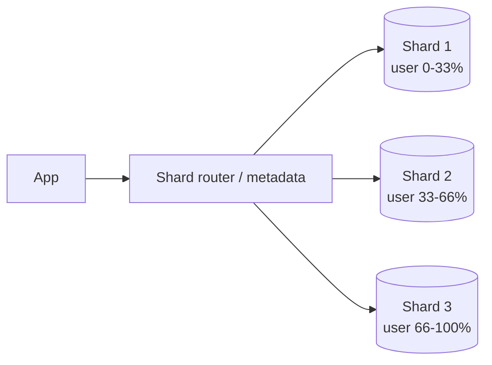

When one database can no longer hold the data or take the writes, you split it. Sharding is how nearly every large system scales storage and write throughput.

## TL;DR

- **Sharding** splits a dataset into partitions, each on its own node.
- Strategies: **range**, **hash**, and **directory (lookup)** based.
- The **shard key** is the most important decision: it drives balance and query cost.
- Cross-shard joins, transactions and secondary indexes become hard.
- Plan for **resharding** from day one.

## The idea in plain English

A library too big for one building is split into branches by author surname. Finding a book is easy if you know the surname; asking "which books are about whales?" means visiting every branch.

## Core concepts

1. **Range sharding.** Keys split into contiguous ranges. Great for range scans; prone to hot spots (for example timestamps).
2. **Hash sharding.** `hash(key)` picks the shard. Even spread; range queries must hit all shards. Use [consistent hashing](/system-design/patterns/consistent-hashing) to ease resharding.
3. **Directory sharding.** A lookup service maps keys to shards. Flexible, but the directory becomes critical.
4. **Shard key choice.** High cardinality, even access, and aligned with the main query.
5. **Secondary indexes.** Local (per shard, scatter-gather reads) or global (partitioned by index term, slower writes).
6. **Resharding.** Splitting or merging shards online with dual writes, backfill and cutover.

## Architecture

## Deep dive

### Hot shards

A celebrity or a sequential key can overload one shard. Mitigations: add a salt to the key, split hot shards, cache hot reads, or isolate large tenants.

### Cross-shard operations

Prefer designs where one request touches one shard. When you cannot, use scatter-gather for reads and [sagas](/system-design/patterns/saga) for multi-shard writes instead of distributed transactions.

## Trade-offs

| Choice | Gain | Cost |
|---|---|---|
| Range | Efficient range scans | Hot spots |
| Hash | Even load | No range scans |
| Directory | Flexible placement | Extra lookup, critical service |

## Real-world examples

- User and post tables sharded by user id: [Twitter](/system-design/case-studies/twitter), [Instagram](/system-design/case-studies/instagram).
- Short code keyspace split across databases: [URL Shortener](/system-design/case-studies/url-shortener).
- Per-conversation partitioning: [WhatsApp](/system-design/case-studies/whatsapp), [Facebook Messenger](/system-design/case-studies/facebook-messenger).
- Partitioned logs: [Distributed Message Queue](/system-design/case-studies/distributed-message-queue), [Metrics and Logging](/system-design/case-studies/metrics-and-logging).

## Common pitfalls

- Picking a shard key that skews (country, status, time).
- Needing cross-shard joins everywhere.
- No resharding story.
- Sharding too early when replicas and caching would do.

## How to answer in an interview

Justify why one node is not enough with numbers, pick the shard key from the dominant access pattern, name the strategy, and explain hot shards and resharding.

## Related patterns

[Consistent Hashing](/system-design/patterns/consistent-hashing) · [Consistency Models](/system-design/patterns/consistency-models) · [Saga](/system-design/patterns/saga) · [Relational Databases](/system-design/databases/relational-databases) · [NewSQL / Distributed SQL](/system-design/databases/newsql-databases) · [Wide-Column Stores](/system-design/databases/wide-column-stores)

## Further reading

- [Designing Data-Intensive Applications, ch. 6 Partitioning](https://dataintensive.net/)
- [Spanner: Google's Globally-Distributed Database](https://research.google/pubs/spanner-googles-globally-distributed-database-2/)

<InterviewQuestions>
  <InterviewQuestion question="How do you choose a shard key?" category="Design" level="Mid">
    Pick a high-cardinality key that spreads load evenly and matches the main query so most requests hit one shard. Avoid monotonically increasing keys and low-cardinality fields.
  </InterviewQuestion>
  <InterviewQuestion question="Range vs hash sharding?" category="Concepts" level="Junior">
    Range keeps neighbouring keys together for scans but risks hot spots; hash spreads evenly but makes range queries touch every shard.
  </InterviewQuestion>
  <InterviewQuestion question="How do you reshard without downtime?" category="Operations" level="Senior">
    Create the new layout, dual-write or stream changes, backfill history, verify, then switch reads and finally writes, keeping the ability to roll back.
  </InterviewQuestion>
</InterviewQuestions>
