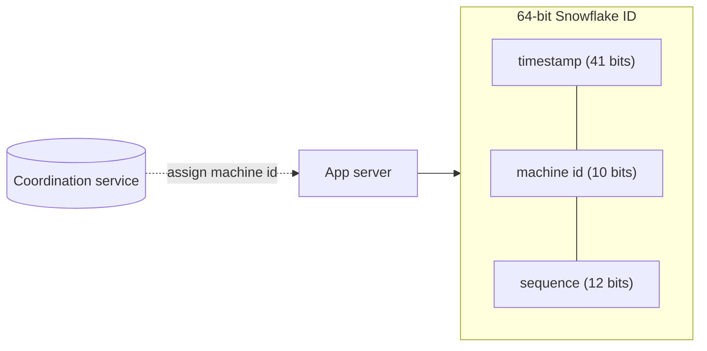

Almost every design needs IDs for rows, messages, orders or short links. At scale, a single auto-increment column stops working.

## TL;DR

- Requirements: **unique**, often **roughly time-sortable**, generated **without a central bottleneck**.
- **UUID v4:** no coordination, but 128 bits and random (poor index locality).
- **Snowflake-style:** timestamp + machine id + sequence in 64 bits; sortable and fast.
- **Ticket server / ranges:** a counter hands out blocks of IDs to app servers.
- For short URLs, encode a counter in **base62** or use hashing with collision checks.

## The idea in plain English

Give each cashier their own ticket roll with a unique prefix and a time stamp. Nobody has to ask a central desk for each number, and tickets still sort roughly by time.

## Core concepts

1. **Auto-increment.** Simple and ordered, but single-writer and exposes volume.
2. **UUID / ULID.** Collision-free by randomness; ULID and UUIDv7 add a time prefix for sortability.
3. **Snowflake layout.** 41 bits time (ms), 10 bits machine id, 12 bits sequence: about 4096 IDs per ms per machine.
4. **Machine id assignment.** Via a coordination service or config; two machines with the same id break uniqueness.
5. **Range allocation.** Each server fetches a block (for example 1000 IDs) from a counter and serves from memory.
6. **Base62 encoding.** Digits plus letters to shorten numeric IDs for URLs.

## Architecture

## Deep dive

### Clock problems

Snowflake depends on a monotonic clock. If the clock moves backwards, wait or refuse to issue IDs until it catches up, and use NTP slewing rather than jumps.

### Counter vs hash for short links

A counter guarantees uniqueness but is predictable and needs coordination. A hash of the URL is stateless but needs collision handling. Many systems use range-allocated counters with base62.

## Trade-offs

| Choice | Gain | Cost |
|---|---|---|
| Auto-increment | Simple, compact | Bottleneck, guessable |
| UUID v4 | No coordination | Large, random index writes |
| Snowflake | Sortable, fast | Needs machine ids and good clocks |
| Ranges | Fast, simple | Gaps, counter is a dependency |

## Real-world examples

- Short codes: [URL Shortener](/system-design/case-studies/url-shortener).
- Message ids ordered per chat: [WhatsApp](/system-design/case-studies/whatsapp), [Facebook Messenger](/system-design/case-studies/facebook-messenger).
- Tweet and post ids with time order: [Twitter](/system-design/case-studies/twitter), [Instagram](/system-design/case-studies/instagram).
- Order and booking ids: [Uber Eats](/system-design/case-studies/uber-eats), [Hotel Booking](/system-design/case-studies/hotel-booking).

## Common pitfalls

- Duplicate machine ids after a redeploy.
- Trusting wall-clock time across machines for strict ordering.
- Exposing sequential ids that leak business volume or allow enumeration.
- Using random UUIDs as a clustered primary key on a write-heavy table.

## How to answer in an interview

State the requirements (sortable? short? unguessable?), pick a scheme, and explain machine-id assignment and clock handling.

## Related patterns

[Sharding](/system-design/patterns/sharding) · [Idempotency](/system-design/patterns/idempotency) · [Leader Election and Consensus](/system-design/patterns/leader-election)

## Further reading

- [Announcing Snowflake (Twitter Engineering)](https://blog.x.com/engineering/en_us/a/2010/announcing-snowflake)
- [RFC 9562: UUIDs (including v7)](https://www.rfc-editor.org/rfc/rfc9562)

<InterviewQuestions>
  <InterviewQuestion question="How do you generate unique IDs across many servers?" category="Design" level="Mid">
    Use a Snowflake-style ID combining a timestamp, a machine id and a per-millisecond sequence, or allocate ID ranges from a central counter, or use UUIDs when ordering does not matter.
  </InterviewQuestion>
  <InterviewQuestion question="Why can UUIDv4 hurt database performance?" category="Trade-offs" level="Mid">
    Random values insert at random places in a B-tree index, causing page splits and poor cache locality; time-ordered IDs append near the end.
  </InterviewQuestion>
</InterviewQuestions>
